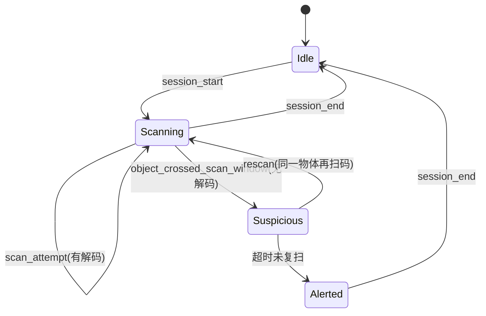

# 规则引擎与会话状态机

> 模板：职责 → 输入 → 输出 → 技术选型 → 训练要点 → 常见陷阱

## 职责

把上游的**原子事件流**按会话组织成**语义判定**：漏扫 / 错扫 / 复扫。它**不是神经网络**，而是符号逻辑 + 状态机，是传统软件最擅长、最该守住的阵地。

> 注意边界：如果需要读 POS 流水才能判定，那这一步就**不属于 $f$**（$f$ 只出视觉语义事件）。此处聚焦"视觉侧"的会话与规则；POS 融合见[集成章节](../engineering/integration.md)。

## 输入

- 上游事件流（实体 / 关系 / 动作事件）；
- `cfg`：ROI 几何、判据阈值、复扫窗口等。

## 输出

- 语义事件：`skip_scan_suspected`、`price_mismatch_suspected`、`rescan_resolved`；
- 会话状态 $s'$。

## 核心：会话状态机

关键规则示例：
- **物体穿越扫描窗 + 窗口内无条码解码** → 疑似漏扫；
- **同一物体随后被复扫** → 判定为"复扫化解"，撤销告警（**必须做，否则全是误报**）；
- **视觉类别 ≠ 录入 PLU** → 疑似错扫（需 POS 侧信号）。

## 技术选型

- 语言：与收银软件同栈的**确定性代码**（C++/C#/Go）；不要用 AI。
- 状态存储：会话级内存态 + 可重放事件日志（事件溯源）。
- 规则表达：优先简单状态机；复杂时可上规则引擎（如 Drools 类），但警惕过度工程。

## "训练"要点

- 无梯度下降。这里的"调参"是**阈值与复扫窗口**，要用真实数据做**离线回放**来标定。
- 用 golden 事件集做回归，保证改规则不引入新误报。

## 常见陷阱

1. **不做复扫判断** → 误报爆炸（这是第一号坑）。
2. **状态泄漏**：会话间状态未隔离，导致串单。
3. **规则硬编码阈值**：阈值应来自业务代价函数，且可配置、可 A/B。
4. **把 POS 逻辑混进来**：破坏 $f$ 的边界，导致无法单独测试视觉侧。

相关：[事件契约](../pipeline/contract.md) · [评测体系](../training/evaluation.md)。
