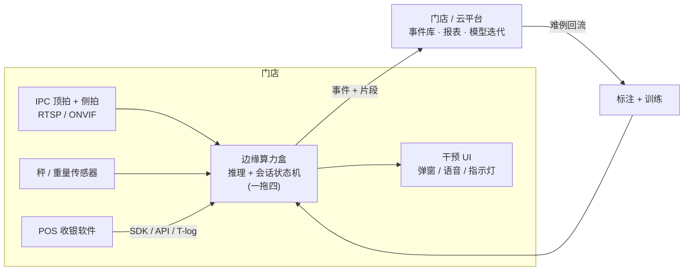
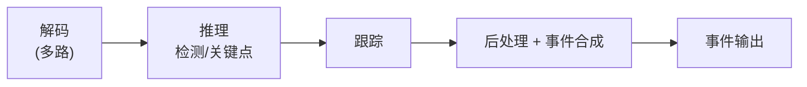

# 边缘架构

## 总体拓扑

## 部署形态

| 形态 | 说明 |
| --- | --- |
| **端侧 / 边缘盒** | 推理 + 会话状态机本地运行，低延迟、隐私友好 |
| **门店服务** | 事件汇聚、看板、本地存储 |
| **云平台** | 报表、跨店分析、模型训练与下发、VLM 离线增强 |

## 与 $f$ 的对应

- **在线主链**：$f_\theta$ 在边缘盒运行，因果、低延迟、端侧。
- **离线复核 / 增强**：更重的模型（含 VLM）在云端对已存片段做二次分析。

两者**共用同一事件契约**——这是"两种运行模式、同一语义"的落地方式。

## 组件协同

$f$ 是一条流水线，边缘盒内各阶段用线程池 / 队列解耦：

- 感知跑全帧率；动作 / 分类可降频。
- 状态（跟踪 id、会话）在盒内维护，严格按会话隔离。

## 可靠性

- **降级**：模型或上游异常时退化为"仅存证"，不阻塞收银。
- **时钟**：盒内统一时钟源，与 POS 对齐（见[集成章节](./integration.md)）。
- **可观测**：延迟、丢帧、推理耗时、事件率均为可监控指标。

## 常见陷阱

1. **一拖四算力不足**：四路全帧率跑重模型必卡；需按需降频 / 分时复用。
2. **状态跨会话泄漏**：收银会话之间必须硬隔离。
3. **网络抖动**：云侧不可用时本地必须能自治。

相关：[端侧部署](./deployment.md) · [与 POS 的融合](./integration.md)。
