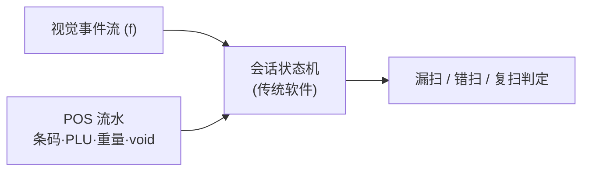

# 与 POS 的融合和时间同步

> 本主题在传统软件范畴，此处只作**接口约定**，重点仍回到 $f$。

## 边界回顾

$f$ **只输出视觉语义事件**；事务级比对（视频事件 × POS 流水）在 $f$ 之外的传统软件中完成。这样：

- $f$ 可独立训练与测试（录像回放）；
- 业务逻辑用确定性代码实现，可审计、可回滚。

## 两条集成路线

| 路线 | 做法 | 优点 | 代价 |
| --- | --- | --- | --- |
| **免对接（纯视觉）** | 不碰收银软件，只读视频 | 部署快、零改造 | 精确率上限低，难判错扫 / 复扫 |
| **对接（融合 POS）** | 通过 SDK / API / 日志拿 T-log、重量、void | 判定准，覆盖全部模式 | 需适配多种 POS，集成成本高 |

**建议**：PoC 走免对接快速验证；产品化走对接。

## 时间同步（命门）

- 视频时钟与 POS 时钟必须**统一时钟域**（NTP / PTP）。
- 每条 POS 流水带**毫秒时间戳**；视频帧打统一时间轴。
- 对齐容差要显式定义（如 ±100 ms），作为契约的一部分。

## 融合判定的输入

$f$ 侧事件（`object_crossed_scan_window`、`scan_attempt`、`hand_holds`）与 POS 侧信号（条码解码、PLU、重量、void）在会话内按时间对齐，由状态机合成最终判定。

## 常见陷阱

1. **时钟漂移**：未统一时钟导致判定系统性偏移。
2. **把融合塞进 $f$**：破坏边界，无法单独测试视觉侧。
3. **POS 适配低估**：不同厂商（海鼎 / 思迅 / 中科英泰 / NCR / Diebold）接口各异，是脏活也是天花板。
4. **回写风险**：对 POS 应保持**只读**，避免影响收银。

相关：[规则引擎](../components/rule-engine.md) · [边缘架构](./edge-architecture.md)。
