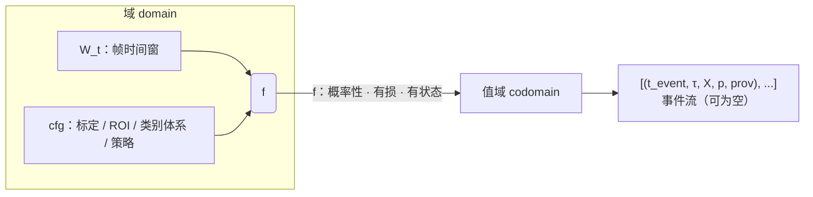
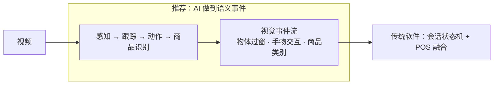

# 把 AI 抽象为 f

## 一句话抽象

把系统中**所有"从像素产生语义"的部分**打包成一个黑箱 $f$，它对外的行为是：

$$
f:\ (W_t,\ \text{cfg}) \longrightarrow \left[\,(t_{event},\ \tau,\ X,\ p,\ \text{prov})\,\right]
$$

即：**输入一段视频时间窗 + 领域配置，输出一条结构化事件流。**

## 为什么是"事件流"而不是"一个事件"

最初的自然想法是

$$
\text{input(video)} \to \text{event}(t, X)
$$

它方向对，但作为工程契约有三处不严谨：

| 朴素版本 | 问题 | 精化 |
| --- | --- | --- |
| input = 单帧视频 | 单帧无法判定动作（"物体掠过扫描窗"是运动） | input = **时间窗内的帧序列** $W_t = \text{frames}[t-W..t]$ + 配置 |
| output = 一个事件 | 一帧里可能同时发生多件事，且事件有持续区间 | output = **事件流** $[\,(t,\tau,X,p)\,]$ |
| 隐含"确定性传感器" | 视频→事件是**有损、概率、非可逆**的映射 | 契约里必须承认不确定性 $p$ 与时间/状态维度 |

## 域与值域

左侧是"非结构化的像素 + 静态先验"，右侧是"结构化的语义事件"。**从像素到符号，就是 $f$ 干的全部事情。**

## 心智模型：$f$ 是一个"概率性传感器驱动"

对传统软件工程师，最贴切的类比是 **sensor driver**：

| 类比 | 对应 |
| --- | --- |
| 传感器的原始读数 | 视频帧 |
| 传感器输出的报文 | 结构化事件 |
| 传感器的量程 / 精度 / 漂移 | 置信度、误漏、光照/视角依赖 |
| 驱动 + 总线协议 | 事件 schema + 传输通道 |

区别在于：这个传感器**会漏报、会误报**，且其精度会随环境**持续漂移**。

## 边界：$f$ 出到哪一层

必须先定义"事件"的含义：是**视觉语义事件**（"物体掠过扫描窗"）还是**业务事件**（"发生漏扫"）？后者需要 POS → **不属于 $f$**。

**推荐切法**：$f$ 的边界停在**视觉语义事件**，把"会话状态机 + POS 比对"留给传统软件。这样 $f$ 的输出是一个干净的、与语言无关的事件契约，也便于用"录像回放"做确定性测试。

## 为什么这个抽象好用

| 好处 | 说明 |
| --- | --- |
| 契约化 | 事件 schema 一旦定死，$f$ 与业务解耦，模型可替换 |
| 可回放 / 可测 | 录好的视频当确定性输入，用 golden 事件集做回归 |
| 流式 / 事件驱动 | $f$ 就是一个 event source，天然接入流处理 |
| 可观测 | 置信度、延迟、模型版本都是可监控字段 |
| 两种运行模式 | 在线（因果、低延迟、端侧）与离线（可看未来、更准、云端复核）共用同一语义 |

下一篇：[f 的要素逐条解读](./elements.md)。
