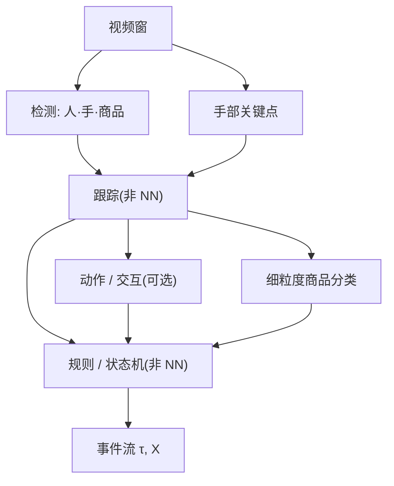

# f 的内部分解：级联 vs 端到端

## $f$ 不是"一个网络"

这是最需要纠正的前提。$f$ 是一条**流水线**：

$$
f = \text{Rule} \circ \text{Classify} \circ \text{Action} \circ \text{Track} \circ \text{Detect}
$$

即多个异构模型（检测 / 关键点 / 分类 / 动作）+ 经典算法（跟踪 / 规则 / 状态机）的复合。**没有哪一个网络能可靠地把 video 端到端变成事件流**，尤其在"实时 + 端侧 + 长尾商品"的约束下。

因此"选型"的正确问法是：**每个子问题该选什么范式**。

## 内部分层

| 层 | 性质 | 输出抽象层级 |
| --- | --- | --- |
| 检测 / 关键点 | 逐帧感知 | 帧级实体 |
| 跟踪 | **数据关联（非 NN）** | 跨帧轨迹 |
| 动作 / 交互 | 时序识别 | 区间级事件 |
| 细粒度分类 | 单帧分类（长尾） | 类别 |
| 规则 / 状态机 | **符号逻辑（非 NN）** | 语义事件 |

> 传统工程师最容易忽视：**跟踪和状态机不是神经网络**——它们是算法。所谓"训练"是调参，不是梯度下降。

## 级联 vs 端到端：核心架构决策

| | **级联（推荐的实时主链）** | **端到端（视频 Transformer / VLM 直接出事件）** |
| --- | --- | --- |
| 数据需求 | 小；各层复用公开预训练 | 极大；需海量视频级 / 事件级标注 |
| 可解释 / 可调试 | 强，误差可定位到某一层 | 黑箱，难归因 |
| 端侧实时 | 能（模型小、可异步） | 难（模型大、延迟高） |
| 长尾商品 | 可用检索 / 人工兜底 | 无解 |
| 指标 | 各层可独立评测 | 端到端好看但不可控 |

**结论**：现阶段唯一能落地实时产品的路线是"级联"。端到端 / VLM 只能作为**离线增强**——证据片段描述、自然语言检索、难例挖掘——绝不放在实时主链上。

## 误差复合

级联的代价是**误差层层累积**：

因此：
- 每层要输出**置信度**，供下游加权；
- 关键层的**召回率**优先于精度（宁可下游有冗余，不可中途丢失）；
- 用 `prov` 记录流水线组成，便于定位是哪一层出错。

## 最小可用流水线（MVP）

起步阶段**甚至不需要动作识别模型**：

$$
f_{\text{mvp}} = \text{Rule} \circ \text{Track} \circ \big(\text{Detect} + \text{HandPose}\big)
$$

"检测 + 关键点 + 跟踪 + 规则"（手进入扫描区、物体穿越窗口、无对应解码）即可覆盖 skip-scan 的大头。**先用规则，规则到天花板了再上模型。**

下一篇：[事件契约：类型 τ 与载荷 X](./contract.md)。
