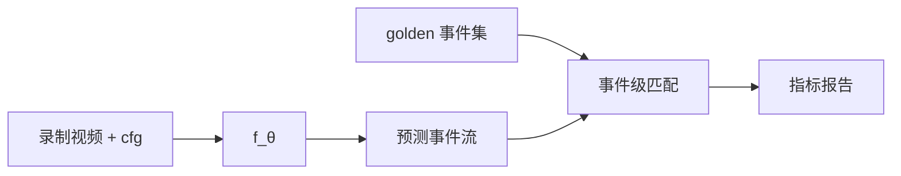

# 评测体系

## 核心原则

**分层指标 + 端到端指标；端到端才是业务真相。** mAP 高不等于业务好。

| 层 | 指标 | 说明 |
| --- | --- | --- |
| 检测 | mAP，但更关心关键类（手 / 商品）的 **recall** | 上游丢目标会传导 |
| 跟踪 | MOTA / IDF1 / HOTA | id 保持质量 |
| **事件级** | **precision / recall / F1** | **业务指标** |
| 系统级 | **误报 / 千次、漏报率、干预率、自纠率、客诉率** | 最终 KPI |

## 离线回放：把 $f$ 当可测函数

$f$ 的"域 → 值域"是确定性的（固定 $f_\theta$ 与 cfg），因此可以用**录像回放**做回归测试：

**事件匹配算法要点：**
- 按 $(t_{event}, \tau)$ 匹配，允许 **±N 帧时间容差**（事件时间有抖动）；
- 区分"匹配 / 漏报(FN) / 误报(FP)"；
- 报告按切片（门店 / 相机 / 时段 / 商品类）拆分。

## golden 事件集

- 人工审定的事件真值，覆盖各漏损模式与边界案例；
- 版本化，与数据集切片对应；
- 每次模型 / 规则变更都跑一遍，防止回归。

## 阈值标定

阈值由**业务代价函数**决定，而非 0.5：

$$
\tau^\* = \arg\min_\tau\ \big(\text{漏报代价}\cdot \text{FN}(\tau) + \text{误报代价}\cdot \text{FP}(\tau)\big)
$$

- 漏报代价 = 货损；误报代价 = 顾客被冤枉 + 店员疲惫（alert fatigue）。
- 两者量级差异巨大，**必须显式建模**。

## 常见陷阱

1. **只看 mAP**：与实际业务脱节。
2. **无时间容差**：事件时间抖动会吃掉 F1，得出错误结论。
3. **没有 golden set**：改动无回归保护，误报悄悄上升。
4. **不做切片分析**：平均指标掩盖长尾崩塌。

相关：[训练配方](./recipe.md) · [事件契约](../pipeline/contract.md)。
