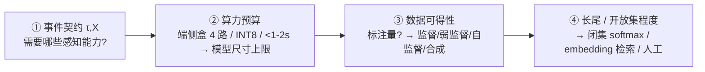

# 训练范式

## 范式总览

| 范式 | 何时用 | 备注 |
| --- | --- | --- |
| **预训练 + 微调** | 主流；大 backbone 通用预训练 → 小数据微调 | **首选** |
| **自监督**（VideoMAE / MAE） | 有大量无标注视频时做预训练 | 减少标注依赖 |
| **弱监督 MIL** | 只有"这单有漏扫"的视频级标签 | 避免昂贵的区间标注 |
| **主动学习 / 难例挖掘** | 持续提升，配合数据闭环 | 性价比最高 |
| **半监督 / 伪标签** | 少量标注 + 大量未标注 | 注意伪标签噪声 |
| **域适应** | 合成→真实、跨门店视角迁移 | 关键工程手段 |
| **长尾技巧** | focal loss、重采样、logit adjustment、解耦训练 | 商品分类必备 |

## 决策流程

## 一个具体推演

假设手里只有几百个漏扫正样本（大概率如此）：

1. ② 决定不能用大模型 → 选 YOLO nano/s 级检测 + MediaPipe Hands；
2. ③ 少量标注 + 正样本稀疏 → **不能端到端训**，必须级联 + 规则；
3. ④ 商品长尾 → 闭集分类器会崩，用 CLIP embedding + 近邻检索兜底。

**结论**：复用预训练 backbone + 微调 + 规则引擎，别从零训。

## 误差复合与联合训练

- 级联各层**独立训练**是默认策略（数据效率高、可局部迭代）。
- 联合微调（end-to-end fine-tune）谨慎使用：需要各层都有足够标注，且容易过拟合小数据。

相关：[训练配方](./recipe.md) · [评测体系](./evaluation.md)。
