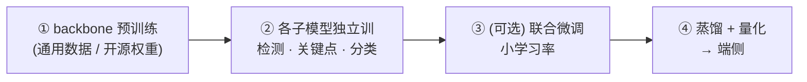
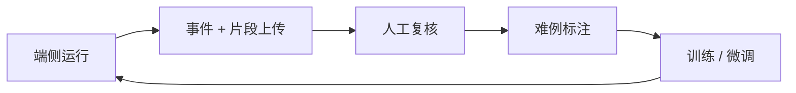

# 训练配方

## 分阶段流程

**别一上来端到端联训。** 分阶段能在每层独立验证、独立回滚。

## 关键超参与策略

| 环节 | 要点 |
| --- | --- |
| Backbone | 用 COCO / ImageNet / 视频数据集预训练权重，冻结后再微调 head |
| 学习率 | 小数据：冻结 backbone + 小 lr 微调 head；数据多再解冻 |
| 数据增强 | 遮挡 / 光照 / 视角抖动；**以真实分布为主**，别过度 |
| 损失 | 检测 CIoU + DFL；分类长尾 focal / 重加权；动作 CE / BCE |
| 批大小 / 迭代 | 按 GPU 内存与收敛曲线调；小数据小 batch + 早停 |
| 正则 | Dropout / weight decay / EMA；小数据尤其重要 |

## 分布对齐（决定成败）

训练分布必须 ≈ 部署分布：**同一相机、同一视角、同一光照、同一商品构成**。跨门店泛化差是这一行的通病，对策：

- 每店 / 每相机分别微调；
- 或做视角归一化（几何校正 + 统一 ROI）；
- 或大量采集多样化数据进行域随机化。

## 数据闭环

人工复核结果回流 → 主动学习挑难例 → 周期性更新模型。**这是误报率能持续下降的唯一途径。**

## 常见陷阱

1. **跳过预训练**：小数据从零训 = 必然过拟合。
2. **联训过早**：各层数据不齐时联训会互相拖累。
3. **过拟合增强分布**：把增强出来的假分布当成真实分布。
4. **不记录版本**：没有 `prov` 就无法复现与回滚。

相关：[训练范式](./paradigms.md) · [评测体系](./evaluation.md) · [端侧部署](../engineering/deployment.md)。
