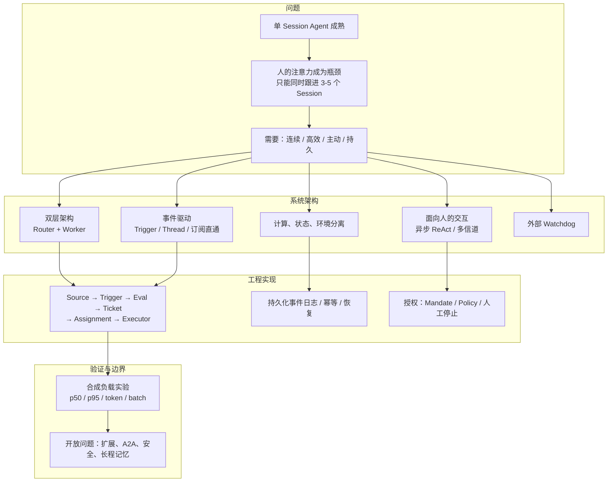

# Super-agent 学习

> 目标：理解 DeepSeek Harness 团队提出的 Super-agent 概念，掌握其架构、关键机制、工程实现与适用边界，能够判断“什么时候该用、怎么落地、哪里会坏”。

## 资料基线与说明

本目录以 2026-10-31 DeepSeek Harness 团队发布的
《Super-agent 设计探索：迈向更自主的 Agent 系统》为主干，配合官方原型仓库
`deepseek-ai/dsh-superagent-prototype` 的文档与源码，以及 Anthropic 的
Managed Agents、Building Effective Agents、Multi-Agent Research System 三篇工程文章做对照。

你提供的知乎链接（`zhuanlan.zhihu.com/p/2099987320443237060`）在当前环境返回 HTTP 403，
无法直接读取。根据公开转载与标题，它对应同一篇文章，但本书未能直接核验页面内容；
本笔记以原文、官方仓库和公开转载为准，不把知乎页面当作独立信源。
所有引用见[参考资料](./src/appendix/references.md)。

## 学习方式

沿用 `learning-with-ai/CLAUDE.md` 的约定：

- 通过提问向 Teacher 学习，问答沉淀到 `qa/NNN-主题.md`。
- 追问追加到原文件，不覆盖。
- 数学部分写清输入、输出、计算过程，使用 LaTeX。
- 图表使用 mermaid。
- 每阶段末把问答沉淀进 mdbook 章节。

## 体系地图



## 分期路线（建议 4 期，每期 2-4 小时）

| 期 | 主题 | 对应章节 | 学完应能回答 |
|---|---|---|---|
| 1 | 问题、定义、总体架构 | 第 1-2 章 | Super-agent 与“多开几个会话/多 Agent”有什么本质区别？ |
| 2 | 调度与事件 | 第 3-4 章 | Router 为什么不成为瓶颈？订阅直通、两级过滤、Inline & Spill 各解决什么？ |
| 3 | 交互与持久化 | 第 5-6 章 | 异步 ReAct 如何做到全双工？存算分离与 Watchdog 如何保证长期在线？ |
| 4 | 实现、实验、边界 | 第 7-10 章 | 原型如何落地授权与恢复？实验数字能信到什么程度？何时不该用？ |

## 预置问题清单

学习时按顺序提问，回答追加到 `qa/`：

1. 为什么说“多任务的上限取决于人的注意力”，而不是模型能力？
2. Super-agent 的四个特征分别由哪个模块支撑？是否存在一个模块支撑多个特征？
3. Router 只做分派、不配 Bash，为什么反而更快？批处理的上限在哪里？
4. Router 层与常见的 Agent Team / orchestrator-worker 有什么本质区别？
5. 事件过滤为什么采用“程序 Fast Path + 模型 Slow Path”？如何评估过滤质量？
6. 订阅与直通如何避免 Router 成为所有后续事件的转发瓶颈？多对多订阅如何解决冲突？
7. Inline & Spill 与 RAG、上下文压缩、记忆系统分别是什么关系？
8. 链式召回为什么能缓解长程记忆问题？它的失败模式是什么？
9. 异步 ReAct Loop 如何改变工具协议与状态机？“已启动”返回意味着什么？
10. 存算分离之后，为什么执行环境反而要留在本地？BYOM 的收益与风险是什么？
11. Watchdog 为什么必须是“外部控制回路”？它如何判断任务“没有实质进展”？
12. 原型的授权模型（Mandate / Policy / accept mode）如何防止“主动”变成“越权”？
13. 实验结果中 p50/p95、token、batch 三个指标各自证明了什么、没有证明什么？
14. 如果要在自己的团队落地，最小可行版本应该先做哪三个模块？

## 第 1 期学习记录

- [001：Super-agent 全景](./qa/001-super-agent-全景.md)：概念、架构与第一性判断

后续问答按 `qa/NNN-主题.md` 追加，阶段末汇总回本书章节。

## 目录结构

```
super-agent/
  README.md                 # 本文件：路线、问题、资料
  book.toml                 # mdBook 配置
  src/                      # 正文
    intro.md
    overview/               # 问题与架构
    design/                 # 五个模块的设计细节
    implementation/         # 原型实现
    evaluation/             # 实验与解读
    analysis/               # 对比、开放问题、安全
    appendix/               # 术语、参考资料
  qa/                       # 问答沉淀
```

## 一句话结论

Super-agent 不是“更大的模型”或“更多的 Agent”，而是把 Agent 从**单次会话**提升为**常驻系统**：
用调度、缓存、存算分离、看门狗等经典系统思想，接管会话管理与上下文同步，
让人从“执行细节”上移到“决策与验收”。它的价值与代价都来自同一个选择：
**用更多 token 和系统复杂度，换取时间、稳定性与人的注意力。**
