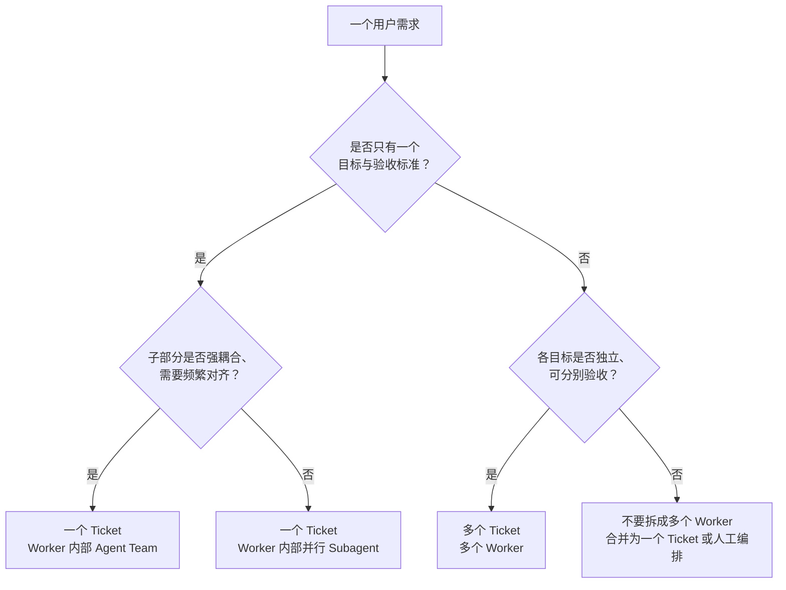
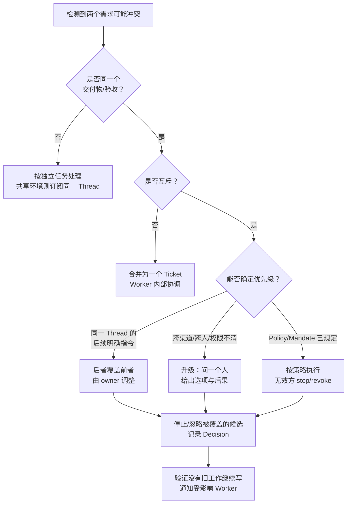

# 002：Router 与 Team Leader 的区别

> 追问：Router 是否需要把一个用户需求拆解为多个需要协作的子任务，交给多个 Worker？
> 这些子任务是彼此独立，还是彼此耦合需要协作？

## 短答

**不需要。** 在 Super-agent 的设计里：

> **一个用户需求 = 一个 Ticket = 一个 Worker（这个 Worker 内部可以是一个 Agent Team）。**

Router 负责“任务之间”的准入、分派与全局协调，**不负责“单任务内部”的拆解**。
把多个 Worker 用于同一个需求的子任务，是把 Team Leader 的职责错误地放到了 Router 上。

原文的原话是：

> Router 层只处理任务之间的高层关联与分派，无需介入单任务内部拆解。

## 1. 两层各自看到什么

| | Router | Worker / Team Leader |
|---|---|---|
| 上下文 | 全局但浅：跨任务摘要、Ticket 列表、策略 | 局部但深：完整任务、代码、工具、执行细节 |
| 时间尺度 | 任务级：接单、分派、汇总 | 步骤级：规划、执行、验证、重试 |
| 主要动作 | accept / attach / stop / ignore / relay | 拆解、实现、调试、合并子结果 |
| 模型要求 | 轻量模型通常够用 | 通常需要最强模型 |
| 失败模式 | 分派错、全局瓶颈 | 任务做错、局部卡死 |

**拆解需要深上下文。** 要判断一个需求该拆成哪些子任务、依赖关系是什么、谁先谁后，
必须理解代码、约束、验收标准。这些信息在 Worker 手里，不在 Router 手里。
Router 如果要做拆解，就得把任务细节读进自己的上下文，结果会：

1. 上下文膨胀，批处理变慢，全局吞吐下降；
2. 从“调度器”退化成“Team Leader”，成为任务质量的单点；
3. 与 Worker 的职责重叠，架构的分离失去意义。

## 2. 为什么不是“多派几个 Worker 并行做子任务”

因为 Super-agent 的多 Worker 层**没有为“同一个交付物的子任务合并”设计语义**。

- Ticket 是结果单位：一个 Ticket 产生一个结果/交付物；
- Worker 向 Router 汇报状态与结果，Router 汇总对外回复；
- Router 不做技术合并，也没有“等待所有子任务完成并 reduce 成最终交付物”的机制；
- 多个 Ticket 产生的是多个独立结果，不是一个结果的多个部分。

如果你把一个需求拆成 3 个 Worker 的子任务，就要回答：

- 谁定义子任务之间的接口？
- 谁等待所有子任务完成？
- 谁合并结果、解决冲突、做最终验证？
- 子任务失败时，谁决定重试/回滚/重新规划？

这些是 Team Leader 的职责，不是 Router 的职责。原文把这类工作放在 Worker 内部：
Worker 可以再创建 Subagent，也可以本身就是一个 Agent Team，对上层 Router 透明。

## 3. 子任务是独立还是耦合？

答案是：**取决于你放在哪一层。**

| 场景 | 放在哪一层 | 原因 |
|---|---|---|
| 同一个目标、强耦合、需要频繁对齐 | **一个 Worker 内部的 Agent Team** | 共享上下文，步骤级协调，最终由一个 owner 合并 |
| 同一个目标、子部分相对独立 | **一个 Worker 内部的并行 Subagent** | 仍由一个 Ticket 拥有验收与合并 |
| 不同目标、彼此独立 | **多个 Ticket / 多个 Worker** | 不需要共享上下文，Router 分派即可 |
| 不同目标、但共享环境（同一 PR/仓库） | **多个 Ticket + 订阅同一 Thread** | 通过共享事件发现冲突，不做步骤级协作 |
| 不同目标、又强耦合 | 不建议拆成多个 Worker | 需要 A2A/人工编排，或合并成一个 Ticket |

关键判断不是“子任务看起来像不像两件事”，而是：

> **它们是否共享同一个目标、同一份验收标准、同一份关键上下文？**

如果是，就应该有一个 Worker 作为 owner；内部分工用 Team/Subagent。
如果不是，才是多个 Ticket。

## 4. 一个决策规则

注意：图里的“一个 Ticket”意味着**一个 owner 对最终结果负责**。
即使内部并行，验收与合并仍然在 Worker 内部完成，Router 不参与技术合并。

## 5. 常见误区

### 误区一：把“多个文件/多个模块”当作多个子任务

一个需求改 10 个文件，仍然是**一个任务**。文件数量不是拆分依据，目标与验收才是。

### 误区二：把“多个 Worker 订阅同一个 PR”当作协作拆解

多个 Worker 订阅同一个 Thread，是为了**发现冲突**（例如两个任务都碰同一个 PR），
不是把一个任务拆成多个子任务。它们各自仍是独立 Ticket。

### 误区三：让 Router 做“计划”

Router 可以做路由决策（接单/忽略/挂到已有 Ticket），但不做技术计划。
如果它开始输出“先做 A，再做 B，然后 C”，它已经越界成 Team Leader 了。

### 误区四：以为“并行”一定更快

强耦合子任务并行，会带来同步、冲突、重复劳动和合并成本。
很多时候，一个 Worker 顺序做，或者内部用 Team 协调，反而更快、更稳。

## 6. 什么时候确实需要 Team Leader

以下情况适合在**一个 Worker 内部**放一个 Team Leader：

- 任务复杂到需要动态拆解，子任务数量/依赖在开始时不明确；
- 子任务之间需要频繁交换中间结果；
- 最终交付物需要统一风格、统一验证、统一合并；
- 失败需要重新规划，而不是简单重试。

这些正是 Agent Team / orchestrator-worker 的强项。Super-agent 并不排斥它，
只是把它放在 Worker 层，而不是 Router 层。

## 7. 一句话总结

> **Router 决定“这件事要不要做、归谁做”；Team Leader 决定“这件事怎么做、拆成几步”。**
>
> 一个用户需求默认交给一个 Worker；Worker 内部可以是一个 Team。
> 多个 Worker 用于多个独立任务，而不是同一个任务的协作子任务。

## 8. 追问：两个需求强耦合，或者互相矛盾，Router 怎么处理？

### 8.1 先把“耦合”拆成四种

“强耦合”和“矛盾”不是同一种问题，处理层级也不同。

| 类型 | 例子 | 本质 | 应该放在哪 |
|---|---|---|---|
| 目标耦合 | 同一个功能的前端 + 后端 + 测试 | 共享一个交付物与验收 | 一个 Ticket，Worker 内部 Team |
| 环境耦合 | 两个独立任务都改同一个 PR/仓库 | 共享写环境，但目标不同 | 多个 Ticket + 订阅同一 Thread |
| 约束冲突 | “用 Postgres” vs “用 SQLite” | 互斥选择，必须有优先级 | 一个 owner + 人或 Policy 决策 |
| 优先级冲突 | 两个都合理，但资源/时间不够 | 排序问题 | 人/Policy 决定顺序 |
| 信息冲突 | 旧方案 A vs 新方案 B | 事实/意图更新 | 同一 owner 按时间与来源判断 |

关键区分：

- **目标耦合**是“怎么拆”的问题；
- **约束冲突/优先级冲突**是“听谁的”的问题。

Router 对这两类问题的处理方式不同：前者是**不要拆**，后者是**不要并行**。

### 8.2 Router 能做什么、不能做什么

原型给 Router 的工具很克制：

| 能做 | 说明 |
|---|---|
| `decide` | 对候选做 accept / stop / ignore / unavailable |
| `attach` | 把一个 Trigger 挂到已有 Ticket，但**要求显式引用**（PR、Issue、原消息、ack，或唯一匹配的最近变更）；主题相似不够 |
| `note` | 把跨任务的事实作为文本 Input 给 Ticket；只提供信息，不授予权限 |
| `reply` | 统一对外回复 |
| `requestStatus` | 询问等待中的 Executor |
| `handback` | Worker 把超出范围的事件交回，由 Router 重新评估 |

| 不能做 | 后果 |
|---|---|
| 合并两个 Ticket | 原型没有 Ticket merge 命令；只能 stop/attach/note，或人工重开 |
| 深入判断技术矛盾 | Router 上下文浅，容易基于摘要做错判断 |
| 代替人停止已授权的工作 | 原型中 `stopTicket` 是人的命令；Router 可对候选做 stop 决策，但人工停止/策略撤销才是最终权威 |
| 跨 Worker 合并子结果 | 没有 join/reduce 语义；多个 Ticket 产生多个独立结果 |
| 自动裁决两个人的冲突 | 没有通用优先级算法；需要 Policy/人工 |

原文说 Router 是“全局的序点、协调点和记忆”。**序点意味着它可以串行化决策，不意味着它能自动判断哪个决策在语义上正确。**

### 8.3 强耦合：默认不要拆成两个 Ticket

如果两个需求共享同一个交付物、同一份验收标准、同一份关键上下文：

1. **首选**：合成一个 Ticket，由 Worker 内部 Team/Subagent 分工；
2. 如果已经开了两个 Ticket：
   - 明确一个 owner，另一个降级为 context/子任务；
   - 通过 `note` 传递跨任务事实；
   - 让它们订阅同一个 Thread，至少能看到彼此的写操作；
   - 如果耦合变成步骤级，停止其中一个，合并回一个 Ticket，或升级给人重新规划。
3. **不要**让两个 Worker 在没有任何协调的情况下同时改同一个交付物。

判断标准还是那句：**同一个目标、同一份验收、同一份关键上下文，就应该只有一个 owner。**

### 8.4 矛盾：不要用并行去“解决”矛盾

矛盾不是“多派一个 Worker”能解决的问题。两个互斥的方案并行执行，只会产生：

- 两份互相冲突的改动；
- 重复劳动；
- 谁先 merge 谁赢的竞态；
- 事后无法解释的决策。

Router 的处理顺序应该是：

几个原则：

1. **先判断是不是同一个交付物**。不是，就按独立任务处理；是，才进入冲突处理。
2. **同一 Thread 内，后出现的明确人工指令通常覆盖前者**。这是原文连续性的例子：IM 里说方案 A，PR 评论里改成 B，Agent 应理解并调整。
3. **跨渠道/跨人时，不要靠“主题相似”猜优先级**。原型的 `attach` 明确要求显式引用；主题相似不够。猜错会把两个不同任务错误合并。
4. **无法确定优先级时，升级给人**。只问一个具体问题，给出选项与后果，而不是让模型“权衡一下”。
5. **一旦决定，先停掉被覆盖的工作，再开始新工作**。不要指望两个 Worker 最后自己合并。
6. **记录理由**：谁、何时、在哪个渠道、依据哪个 Policy 版本、为什么选 A 不选 B。否则事后无法审计。

### 8.5 两个具体例子

**例一：Postgres vs SQLite**

- 同一个服务、互斥的存储选型。
- Router 不应该开两个 Ticket 并行。
- 正确做法：合成一个 Ticket，把两个约束都交给 owner；owner 发现互斥后，通过结构化问题问人：
  “生产用 Postgres、测试用 SQLite，还是统一 Postgres？”
- 如果两个 Ticket 已经开了：停止一个，把它的上下文 `note`/`attach` 给另一个；不要让两套 migration 同时写。

**例二：IM 里说方案 A，PR 里改成方案 B**

- 这是同一个任务、同一个 owner 的后续变更，不是两个任务。
- Router 的职责是确保 B 到达拥有该 Ticket 的 Worker（后续消息直通/attach/relay），并更新全局记忆。
- Worker 按 B 调整；A 的相关工作如果还没做，取消；如果已经做了，评估是否需要回滚。
- 如果 A 和 B 来自不同的人、权限相同、时间接近，Router 不应擅自选一个，而应升级给人确认。

### 8.6 一句话

> **Router 不负责“解决”矛盾；它负责阻止矛盾变成并行执行。**
>
> 强耦合 → 合成一个 owner；矛盾 → 定优先级或升级给人；已经并行 → 先停一个，再协调。
> 真正的技术裁决与结果合并，仍然在 Worker/Team Leader 或人手里。

## 延伸阅读

- [正文：Router 与 Worker](../src/design/router-worker.md)
- [正文：与 Agent Team 的区别](../src/analysis/comparison.md)
- [正文：原型实现](../src/implementation/prototype.md)
- [原文：Super-agent 设计探索](https://mp.weixin.qq.com/s/zoS7GlReWPhfCjENGxXCdg)
