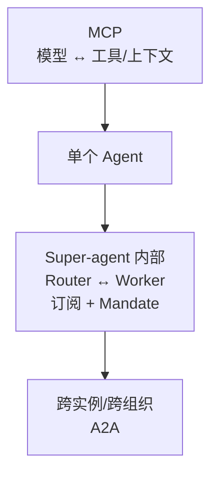

# 对比：Super-agent 在 Agent 版图中的位置

## 9.1 一张定位表

| 方案 | 并发单位 | 上下文归属 | 人的界面 | 持久化 | 授权模型 | 典型场景 |
|---|---|---|---|---|---|---|
| 单 Session + Subagent | 子任务 | 主 Session 共享 | 一个聊天窗口 | 依赖宿主 | 宿主权限 | 单任务、短周期 |
| Agent Team | 角色/子任务 | Team Lead 协调 | 一个主会话 | 依赖宿主 | 宿主权限 | 单任务内部协作 |
| Super-agent | 任务/Ticket | Router 全局 + Worker 隔离 | 多信道、一个 Agent 身份 | 计算/状态/环境分离 | Mandate/Policy | 多任务、常驻、主动 |
| Anthropic Managed Agents | 长周期会话 | Session 事件日志 + Harness | 托管产品界面 | 三者接口分离 | 平台 + vault | 托管长任务、企业 VPC |
| 工作流引擎 | 预定义步骤 | 引擎状态 | 运维界面 | 强 | 应用定义 | 确定性流程、批处理 |
| A2A 多 Agent | 独立 Agent | 各自内部，不共享 | 协议调用 | 各自负责 | Agent Card/认证 | 跨组织/跨框架协作 |

这张表只用于定位，不是优劣排序。不同方案解决不同问题。

## 9.2 vs 单 Session + Subagent

| 维度 | 单 Session + Subagent | Super-agent |
|---|---|---|
| 上下文 | 主 Session 共享，连续性强 | Router 全局 + Worker 隔离，连续性与并发分离 |
| 并发 | 受主 Session 单 ReAct Loop 限制 | Worker 层可并行 |
| 委派决策 | 依赖提示词与模型临场判断 | 系统层强制 Router 只分派、Worker 只执行 |
| 稳定性 | 对提示词高度敏感（0/5 vs 4/5） | 行为由架构约束，不靠模型自觉 |
| 成本 | 较低 | 较高（多会话与更多 token；直通消融显示无直通时再 +37%） |
| 适用 | 单任务、任务间耦合紧 | 多任务、任务间较独立 |

关键区别不是“有没有 Subagent”，而是**委派是否由系统保证**。
Subagent 是工具，模型可以用也可以不用；Super-agent 的双层是结构，Router 不执行具体任务。

## 9.3 vs Agent Team / orchestrator-worker

| 维度 | Agent Team | Super-agent |
|---|---|---|
| 拆分对象 | 单个复杂任务内部 | 多个任务之间 |
| Lead 负载 | 理解细节、规划子任务、高频协调 | 高层分派、对外交互、全局记忆 |
| 子任务耦合 | 通常较紧 | 通常较松 |
| 上下文 | 共享/频繁同步 | Worker 隔离 |
| 失败隔离 | 弱，Lead 是单点 | 较强，单 Worker 失败不影响其他 |
| 模型要求 | Lead 通常需要强模型 | Router 可用轻量模型 |

两者不是替代关系。一个 Super-agent 的 Worker 内部完全可以是一个 Agent Team。
原文明确说：Worker 内部可以再创建 Subagent，也可以本身就是一个 Agent Team，对上层的 Router 透明。

## 9.4 vs Anthropic Managed Agents

Anthropic 的 Managed Agents 与 Super-agent 共享“脑手分离”的直觉，但目标不同。

| 维度 | Anthropic Managed Agents | Super-agent |
|---|---|---|
| 问题 | 如何为未知的未来 harness 设计稳定接口 | 如何让 Agent 同时推进多任务、主动响应、长期在线 |
| 抽象 | Session / Harness / Sandbox 三接口 | Router / Worker / 事件 / 状态 / Watchdog |
| 计算 | 无状态 harness，可 `wake(sessionId)` | 云端无状态 Agent Loop |
| 状态 | append-only session log | 会话日志 + 任务/工单/授权 |
| 环境 | 沙箱、客户 VPC、自定义工具 | 用户机器（BYOM）、云端机器、按需环境 |
| 安全 | 凭据不进 sandbox；vault + 代理 | 文章列为开放问题；原型有授权但非安全边界 |
| 人的位置 | 产品界面 | 决策与验收；跨 IM/GitHub/邮件 |
| 多 Agent | 多 brain、多 hand；brain 可传递 hand | Router 分派多 Worker；Worker 可嵌套 |
| 评价重点 | TTFT、隔离、弹性、安全 | 完成时间、token、Router 负载、人的注意力 |

一个有用的类比：

- Anthropic 在做 **Agent 的操作系统接口**：进程（harness）、文件（session）、设备（sandbox）；
- Super-agent 在做 **Agent 的调度器与工作流层**：谁来做、什么时候做、做完怎么汇报。

两者可以叠加：Super-agent 的 Worker 可以跑在 Managed Agents 式的沙箱里；
Managed Agents 也可以承载 Super-agent 的 Router/Worker 实现。

## 9.5 vs 工作流引擎 / 持久执行

工作流引擎（如 Temporal、DBOS 一类）解决的是：

- 确定性编排；
- 持久化状态；
- 失败重试；
- 长时间运行；
- 可观测与可恢复。

Super-agent 借用了这些思想（持久副作用、重试、恢复），但有一个根本差异：

| 维度 | 工作流引擎 | Super-agent |
|---|---|---|
| 控制流 | 预定义代码路径 | 模型动态决策 |
| 确定性 | 高 | 低（同一输入可能走不同路径） |
| 步骤 | 明确 | 开放式 |
| 恢复 | 从确定性检查点重放 | 从事件日志恢复 + 模型重新判断 |
| 适用 | 稳定、可枚举的流程 | 开放式、难以预先枚举的任务 |

因此，Super-agent 不能简单“套一个工作流引擎”。它需要工作流引擎的**持久化与恢复能力**，
但控制流仍由模型驱动。原型的 Effect 队列 + Outbox + 读回执，就是这种混合的体现。

## 9.6 vs A2A 与 MCP

### MCP

MCP（Model Context Protocol）解决的是**模型与工具/上下文源**之间的接口：
模型如何发现工具、调用工具、获取资源。它不解决 Agent 之间的任务分派与协作。

### A2A

A2A（Agent2Agent）解决的是**独立、可能不透明的 Agent 系统**之间的通信：

- 能力发现（Agent Card）；
- 任务/消息/工件（Task/Message/Artifact）；
- 异步、流式、推送通知；
- 不要求共享内部状态、记忆或工具。

原型的内部协调**没有使用 A2A**：

- Worker 之间通过共享 Thread 的订阅事件协调，而不是点对点消息；
- Router 与 Worker 是同一系统内部的角色，不是独立 Agent；
- 授权由 Mandate/Policy 在系统内强制，不依赖跨 Agent 协议。

但原文把 A2A 列为开放问题：当组织内/组织间存在多个彼此隔离的 Super-agent 实例时，
跨边界的协同就需要 A2A 式的协议。这时的问题不再是“同一个系统内怎么分派”，
而是“不同权限边界、不同上下文、不同所有者的 Agent 怎么安全协作”。

### 三者关系

## 9.7 与经典系统概念的对应

| Super-agent | 经典系统 | 相同点 | 不同点 |
|---|---|---|---|
| Router/Worker | 调度器/进程 | 中心调度、并发执行 | 调度决策由模型做，不是固定算法 |
| 两级过滤 | Fast/Slow Path | 确定性快路径 + 灵活慢路径 | 慢路径是 LLM，成本模型不同 |
| 订阅直通 | 发布订阅/中断 | 事件直接分发 | 订阅关系由任务生命周期动态建立 |
| Inline & Spill | Cache/虚拟内存 | 局部性、按需换入换出 | 缓存的是语义上下文，不是字节 |
| 链式召回 | 指针追逐/多级页表 | 多跳引用 | 每跳由模型决定是否继续 |
| 投机执行 | CPU 投机 | 提前计算、结果可丢弃 | 副作用需要授权与回滚 |
| Watchdog | 硬件看门狗 | 外部定时监控 | 还能判断任务语义进展 |
| 存算分离 | 云计算 | 计算无状态、状态持久化 | 执行环境留在端侧，BYOM |

这些类比的价值是**迁移已知的失败模式**：

- Cache 有一致性与命中率问题 → Inline & Spill 有陈旧/漏召回问题；
- 投机执行有回滚问题 → Agent 投机有副作用与越权问题；
- 看门狗有误杀问题 → Watchdog 有误判与自监控盲区；
- 发布订阅有重复/乱序 → 订阅直通需要幂等与顺序保证。

## 9.8 什么时候该用 Super-agent

### 适合

- 任务到达率高，人同时跟进多个任务；
- 任务之间相对独立，可并行；
- 跨 IM/GitHub/邮件等多个信道；
- 需要长期在线、设备可能离线；
- 人的注意力是稀缺资源；
- 任务结果可验证（测试、review、验收）；
- 授权边界可定义（谁可以请求、能做什么）。

### 不适合

| 场景 | 原因 |
|---|---|
| 一天只有几个任务 | 双层与持久化的复杂度不划算 |
| 任务高度耦合、必须共享同一份上下文 | Worker 隔离会破坏连续性 |
| 需要严格确定性/可复现 | 模型决策本质不确定 |
| 安全边界无法定义 | 主动 + 多设备会放大风险 |
| 结果无法验证 | 自主执行容易产生难以发现的质量问题 |
| 团队没有 observability | 出问题无法定位，恢复也无从谈起 |
| 单仓库/单任务的小工具 | 单 Session + 工具足够 |

### 一个落地检查清单

1. 你的任务是否真的可以并行？耦合度有多高？
2. 你能定义“谁可以请求工作”和“能做什么”吗？
3. 你有可验证的结果吗（测试、review、指标）？
4. 你能承受多 30-40% 的 token/系统开销吗？
5. 你有事件日志、追踪、回放能力吗？
6. 你能接受“Agent 主动做事”带来的误操作风险吗？
7. 你准备好长期维护调度、恢复、安全这些“非模型”代码了吗？

## 9.9 小结与思考题

**小结**：Super-agent 不是 Agent Team 的替代品，也不是 Managed Agents 的竞品。
它占据的是“多任务、常驻、跨信道、主动”的生态位：向下可以复用沙箱/工具接口，
向内可以用 Agent Team 执行单任务，向外可以用 A2A 连接其他实例。
它的独特性在于**把会话管理从用户手里拿走，并把授权、恢复、注意力作为一等系统问题**。

**思考题**：

1. 为什么 Super-agent 内部协调不使用 A2A？什么情况下必须用？
2. 如果一个任务需要 10 个 Worker 共享同一份设计文档，双层架构还合适吗？
3. 工作流引擎的哪些能力可以被 Super-agent 直接复用？哪些不能？
4. 用一张表比较你所在团队当前的工作方式与 Super-agent 的差异。
5. 选一个你熟悉的 Agent 产品，判断它属于表中的哪一类，为什么。

下一章讨论开放问题、安全与落地判断。
