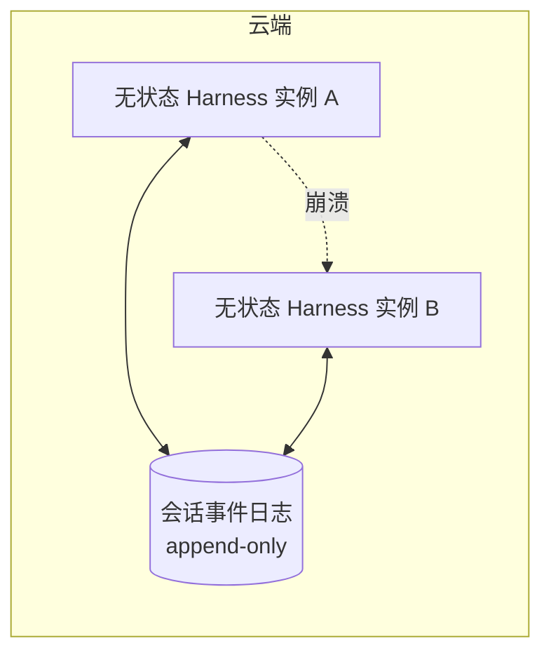
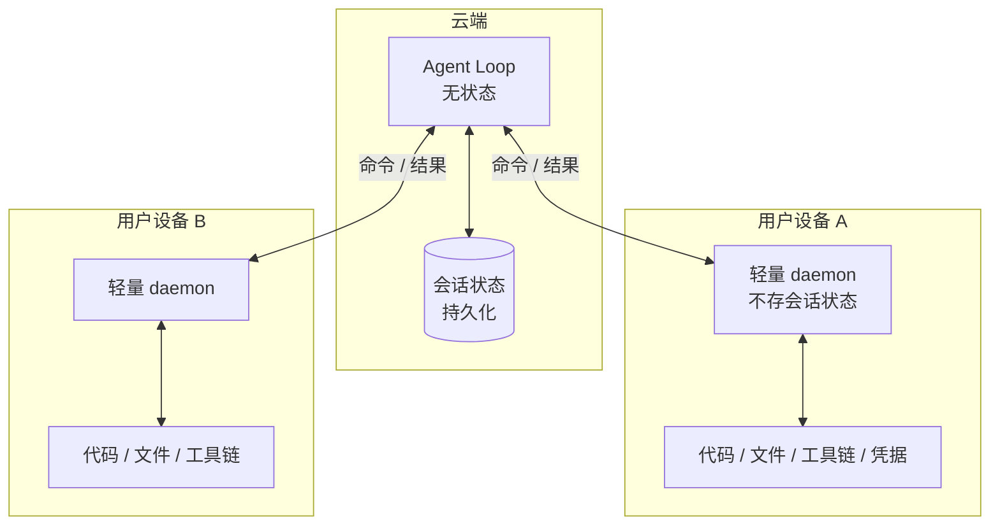
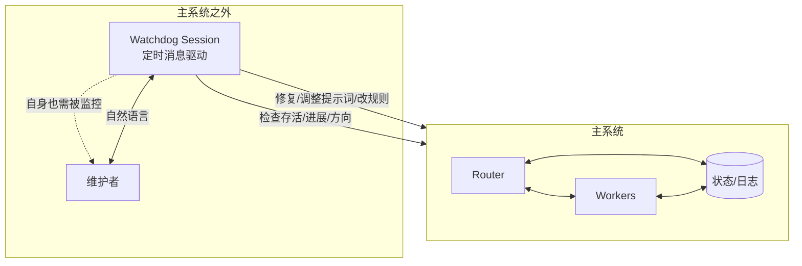
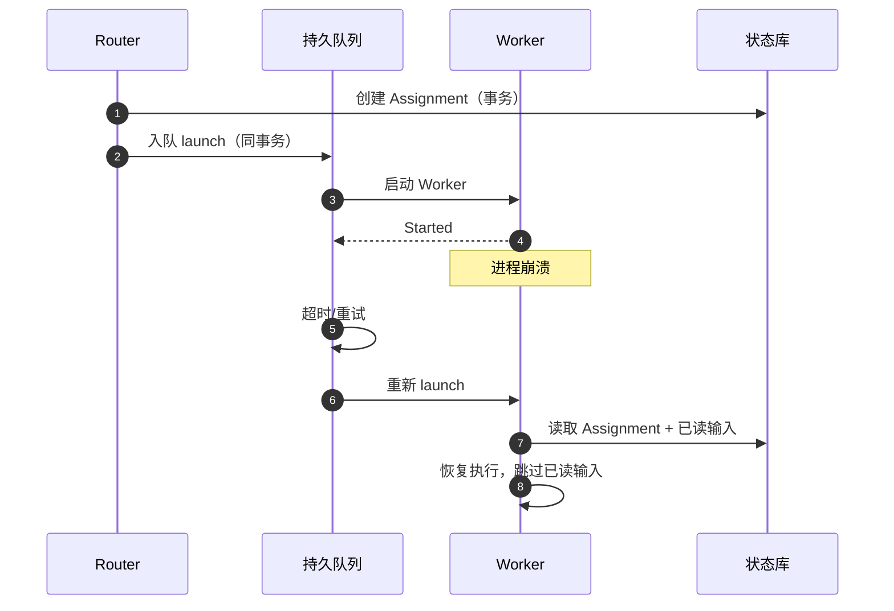

# 持久在线：存算分离与 Watchdog

## 6.1 三样东西被绑在一起

现有本地 Agent 默认把三样东西绑在同一台设备上：

| 组件 | 内容 | 生命周期 |
|---|---|---|
| 计算 | 推进 Agent Loop 的进程/容器 | 设备在线时才存在 |
| 状态 | 会话历史、任务状态、授权 | 理想上应长期保存 |
| 环境 | 代码仓库、本地工具链、凭据 | 与设备绑定 |

这导致三个问题：

1. 设备休眠/离线，Agent 停止；
2. 换设备，状态与环境带不过去；
3. 进程崩溃，正在跑的任务丢失，只能从头再来。

要让 Super-agent 持久在线，需要分两步解耦这三者。

## 6.2 第一步：计算与状态分离

推进 Agent Loop 的计算可以做成**无状态**的；需要持久保存的是会话状态。

做法：

- 计算放入云端无状态弹性容器，可水平扩展、重启、替换；
- Session 等持久化状态存入数据库/事件日志；
- 容器崩溃后，新容器从事件日志恢复上下文，继续执行。

关键性质：

- Harness 不持有不可恢复的状态；
- 任何实例都可以接管任何会话；
- 恢复点是事件日志的最后一条事件；
- 扩容只是多启动几个无状态实例。

这与 Anthropic 的 Managed Agents 设计一致：session 是 append-only 的事件日志，
harness 是无状态的循环，sandbox 是可替换的执行环境。

## 6.3 第二步：计算与执行环境分离

计算与状态上云后，下一个问题是：如何访问任务所需的执行环境？

模型工作所需的上下文很大一部分要通过工具调用从代码仓库、本地文件、依赖服务等执行环境中获取。
从这个意义上说，**广义的上下文也包含执行环境本身**。

常见但不够好的两种思路：

| 思路 | 问题 |
|---|---|
| 在云端启动沙箱，拉取代码并重建环境 | 真实环境常有未提交修改、私有凭据、内网依赖、特定硬件/工具链；复制成本高且易遗漏 |
| 要求用户放弃本地环境，迁往云端 | 迁移成本高；很多用户不愿意/不能 |

Super-agent 的选择是：**既然难以复制和同步的是环境本身，就不必让执行环境跟着 Agent Loop 上云。**

做法：

- Agent Loop 在云端运行；
- 重状态的执行环境留在原地；
- 端侧只部署一个不保存会话状态的轻量 daemon；
- daemon 只负责执行命令与返回结果；
- Agent 按需读取环境中的上下文。

这带来几个能力：

- **BYOM（Bring Your Own Machine）**：把用户日常使用的开发机/个人电脑接入云端 Agent；
- **跨设备**：Agent 不再受限于单台机器，可以根据任务选择执行设备；
- **间歇在线**：设备重新上线后，云端 Agent 可以自动触发并完成需要在该设备上执行的任务；
- **环境原地不动**：未提交修改、本地凭据、内网服务都留在原地。

## 6.4 与 Anthropic “脑手分离”的异同

原文明确说，这一思路与 Anthropic 提出的“脑手分离（Decoupling the brain from the hands）”一致：
让 harness 保持无状态，把会话日志存放在 harness 之外，并通过统一接口按需接入执行环境。

Anthropic 的做法可以概括为三个接口：

| 接口 | 职责 |
|---|---|
| Session | append-only 事件日志，持久保存发生了什么 |
| Harness | 调用模型、路由工具调用的循环，无状态、可重启 |
| Sandbox | 执行代码、编辑文件的环境，可替换、可销毁 |

关键操作：

- `execute(name, input) -> string`：把 sandbox 当成普通工具调用；
- `provision({resources})`：按标准配方创建新 sandbox；
- `wake(sessionId)`：重启一个 harness，从事件日志恢复；
- `getSession(id)` / `getEvents()`：读取事件日志，按位置切片；
- `emitEvent(id, event)`：把事件写入持久日志。

收益（Anthropic 报告）：

- p50 首 token 时间（TTFT）下降约 60%，p95 下降超过 90%；
- 不需要为每个会话预先启动容器；
- 容器失败可以当作工具调用错误处理，重试即可；
- 安全边界更清晰：凭据不进入 sandbox，Git token 在初始化时注入 remote，MCP OAuth token 存在 vault，
  通过代理调用。

两者的区别在**场景**：

| 维度 | Anthropic Managed Agents | Super-agent |
|---|---|---|
| 定位 | 托管服务，长周期 Agent 基础设施 | 个人/团队的常驻自主协作者 |
| 执行环境 | 按需创建的沙箱、客户 VPC 资源 | 用户日常机器（可能间歇在线）、云端托管机器 |
| 首要问题 | 多租户、隔离、弹性、安全 | 连续性、多任务、主动性、人的注意力 |
| 状态 | Session 事件日志 | 会话日志 + 任务/工单/授权状态 |
| 人的位置 | 通过产品界面使用 | 决策与验收；跨 IM/GitHub/邮件 |

Anthropic 的文章解决的是“如何为未知的未来 harness 设计稳定接口”；Super-agent 的文章解决的是
“如何让一个 Agent 同时推进多项工作、主动响应环境、长期在线”。两者共享“脑手分离”的底层直觉，
但上层目标不同。

## 6.5 Watchdog：为什么必须是外部控制回路

存算分离解决了“计算可以重启”，但没有解决“系统在长期运行中能否自己发现异常并恢复”。

持久在线的分布式系统很难仅靠主系统内部逻辑保证长期可靠运行，需要在主系统之外引入独立的
外部控制回路（Control Loop）。原因是：

- 主系统内部逻辑可能自己卡死、陷入循环、判断力下降；
- 进程存活探测只能发现“死了”，发现不了“活着但没进展”；
- 监控脚本只能检查预设指标，无法判断任务方向是否偏离目标。

Super-agent 的做法是：在主系统外部配置一个独立的 **Watchdog Session**，用定时消息驱动它，
构成外部 Control Loop。

### 它监控什么

| 层级 | 监控内容 | 处理 |
|---|---|---|
| 基础设施 | 接口报错、状态恢复失败、进程异常 | 重试、重启、修复 |
| 任务进展 | Worker 是否有实质进展 | 询问、干预、重新分派 |
| 任务方向 | 是否偏离整体目标 | 提醒、纠正、停止 |
| 外部故障 | 偶发网络/API 故障 | 持续复查直至恢复 |

### 它为什么是一个 Agent Session

Watchdog 本身也是一个具备完整工具能力的 Agent Session。这意味着：

- 维护者可以用自然语言向它询问故障原因；
- 它可以读取日志、检查状态、调用工具；
- 它可以在线修正主系统行为，例如增删提示词、调整触发规则；
- 它本身也需要被监控（否则会成为新的单点）。

### 设计要点与盲区

| 要点 | 说明 |
|---|---|
| 独立性 | Watchdog 不能与被监控对象共享同一个故障域 |
| 可观测性 | 需要看到任务进展，而不只是进程指标 |
| 可操作性 | 不能只报警，要能执行修复动作 |
| 可审计 | 所有自动修复都要留痕，人能回滚 |
| 盲区 | Watchdog 自己也可能误判/卡死；需要外部告警或人工巡检兜底 |

## 6.6 恢复语义：至少一次 + 幂等

持久化系统绕不开一个问题：故障恢复后，动作会重复吗？会丢失吗？

Super-agent 原型采用的是一组经典组合：

1. **事件日志 append-only**：所有关键事件先落盘；
2. **副作用先入持久队列**：发消息、启动 Worker、投递输入，先在事务内入队，提交后再执行；
3. **失败重试 + 指数退避**：网络/模型瞬时故障重试；永久故障标记失败；
4. **幂等键**：Trigger 有唯一 ID，重复接收只创建一次 Ticket；消息有收据，避免重复发送；
5. **读回执**：输入是否真正进入 Executor Session 历史，有显式记录；重启后不会重复投递已读消息。

这实现了“**至少一次投递 + 幂等消费**”，而不是昂贵的“恰好一次”。

### 为什么不是恰好一次

分布式系统中，恰好一次（exactly-once）通常需要两阶段提交或事务性消息，代价高、复杂度大。
更常见的工程做法是：

- 允许重复；
- 让每个操作可幂等；
- 用唯一 ID/去重表/收据来消除重复的影响。

### 一个恢复例子

关键不是“永不失败”，而是“失败后可恢复，且重复不产生额外副作用”。

## 6.7 可用性的简单模型

设系统平均无故障时间为 $MTBF$，平均修复时间为 $MTTR$，则稳态可用性：

$$
A = \frac{MTBF}{MTBF + MTTR}
$$

年停机时间约为：

$$
T_{\text{down}} = 8760 \times (1 - A)\ \text{小时}
$$

Watchdog 的作用是缩短 $MTTR$：

- 更早发现异常（降低检测时间）；
- 自动执行修复（降低人工响应时间）；
- 持续复查（避免“修了但没完全好”）。

但 Watchdog 也可能引入误判，增加不必要的重启。设误判率为 $f$，每次误判的恢复成本为 $C_f$，
则净收益需要满足：

$$
\Delta MTTR \cdot \lambda_{\text{fault}} \cdot C_{\text{outage}} > f \cdot C_f
$$

其中 $\lambda_{\text{fault}}$ 是故障到达率，$C_{\text{outage}}$ 是单位停机成本。
这解释了为什么 Watchdog 的判断需要保守：宁可多复查，也不要频繁误杀。

## 6.8 失败模式与缓解

| 失败模式 | 表现 | 缓解 |
|---|---|---|
| 状态与计算不一致 | 重启后重复执行/丢状态 | append-only 日志、检查点、幂等 |
| 端侧 daemon 失联 | 任务卡住、无法访问环境 | 心跳、超时、切设备、人工介入 |
| 凭据泄露 | 提示词注入读取本地凭据 | 凭据不进入模型上下文；vault + 代理；最小权限 |
| Watchdog 误判 | 频繁重启/打断正常任务 | 多信号确认、冷却期、人工确认 |
| Watchdog 自身故障 | 无人监督 | 外部告警、双看门狗、定期人工巡检 |
| 长期运行漂移 | 任务越做越偏 | 目标检查、阶段性验收、上下文重建 |

## 6.9 小结与思考题

**小结**：持久在线由两步解耦 + 一个外部回路组成。第一步把计算与状态分开，让 Harness 可重启；
第二步把计算与环境分开，让真实环境留在原地；Watchdog 在主系统之外监控基础设施与任务进展，
缩短故障发现与修复时间。恢复语义的核心是“至少一次 + 幂等”，而不是追求昂贵的恰好一次。

**思考题**：

1. 为什么“把执行环境复制到云端”在很多场景下不可行？列出三个具体障碍。
2. 如果端侧 daemon 不保存会话状态，它需要保存什么？不需要保存什么？
3. Watchdog 如何判断一个 Worker “没有实质进展”？需要哪些信号？
4. 设计一个幂等的“发送消息”操作，说明去重键是什么。
5. 可用性公式中，Watchdog 主要影响 $MTBF$ 还是 $MTTR$？为什么？

下一章进入官方原型，看看这些设计如何落到领域模型、状态机与代码结构。
