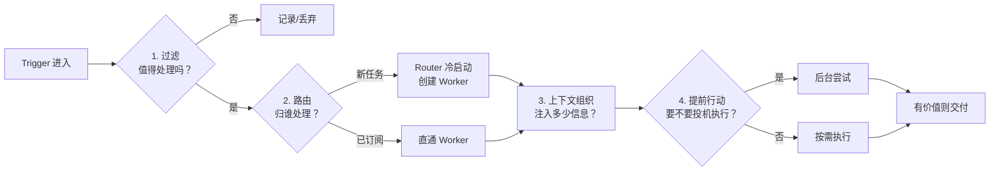
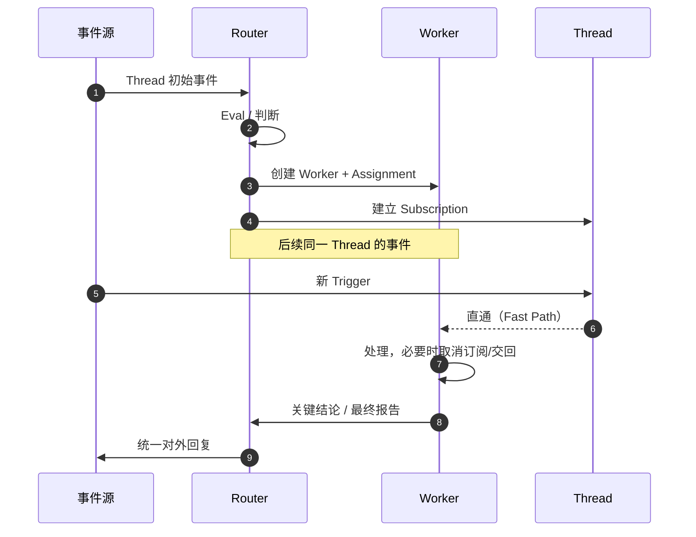
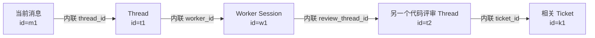

# 事件驱动：从被动响应到主动推进

## 4.1 驱动方式变了：从提示词到环境事件

经典 Agent 的主要输入是人在 Session 中逐条键入的提示词。Super-agent 的主要输入变成
环境中的**半结构化事件**：

- 群聊消息；
- 邮件与日程提醒；
- 代码审查评论；
- CI 运行结果；
- Issue / PR 状态变化。

这些事件在原文中被称为 **Trigger**。

| 概念 | 定义 | 作用 |
|---|---|---|
| Trigger | 一条不可变的环境事件，带来源元数据（如 actor） | 审计与幂等的最小单位 |
| Thread | 同一话题/PR/邮件串下按时间排列的 Trigger 流 | Eval 的上下文单位；原型中同一 Thread 同时只跑一个 Eval |
| Channel | Thread 的写侧，由 Source 定义地址 | 回复、ack、PR、review 等所有对外写操作 |
| Correlation | 一个 Trigger 所属多个 Thread 时的关联关系 | 只增加上下文，不负责路由 |
| Subscription | Ticket 与 Thread 的多对多订阅 | 决定后续事件直通给谁 |

关键区别：

- **Subscription 负责路由**：哪些事件送到哪个 Worker；
- **Correlation 只增加上下文**：让 Eval 能看到相关证据，但不改变事件去向。

把两者混在一起，会导致“看一眼相关 Thread”意外获得授权或改变任务归属。原型在领域模型里
明确把这条规则列为“拒绝的概念”：*Correlation that routes*。

## 4.2 一条事件的生命周期

一条 Trigger 从进入系统到产生行动，经过四个递进问题：

四个问题对应四组机制：

1. **过滤**：程序 Fast Path + 模型 Slow Path；
2. **路由**：订阅与直通；
3. **上下文**：Inline & Spill + 链式召回；
4. **提前行动**：投机执行。

## 4.3 两级过滤：程序先快筛，模型再慢判

真实群聊与代码平台的事件流呈现“高噪音、低触发率”：绝大多数消息不需要 Agent 介入。
如果对每条事件都调用大模型判断，延迟和成本都不可接受。

Super-agent 借用 Fast Path / Slow Path 思想：

| 层 | 实现 | 判断内容 | 特点 |
|---|---|---|---|
| 程序层 | 确定性代码 | 来源、群组范围、用户/机器人白名单 | 低延迟、低成本、可预测 |
| 语义层 | LLM + 提示词策略 | 是否需要行动、是否匹配规则 | 灵活、高成本、可自然语言扩展 |

程序层对不同来源可以设置三种策略：

- **仅响应明确请求**：必须 @ 或直接消息；
- **作为候选事件**：进入语义层判断；
- **直接忽略**：连候选都不是。

语义层同时是“面向人类的自然语言扩展点”：团队可以随时通过提示词开关或新增策略，
而不需要改代码。

### 过滤的成本模型

设单位时间事件数为 $N$，程序层单条成本为 $c_f$，语义层单条成本为 $c_s$，程序层通过率为 $p$。
两级过滤总成本：

$$
C_{\text{two-level}} = N c_f + N p c_s
$$

全部交给模型：

$$
C_{\text{all-LLM}} = N c_s
$$

两级过滤更便宜的条件：

$$
N c_f + N p c_s < N c_s
\;\Longrightarrow\;
p < 1 - \frac{c_f}{c_s}
$$

由于 $c_f \ll c_s$，只要程序层能挡掉大部分噪音（$p$ 不太接近 1），两级过滤就划算。

### 过滤质量：精确率与召回率

过滤不是“越严格越好”。设：

- $FP$：误判为需要处理（浪费注意力/算力，甚至误操作）；
- $FN$：漏掉真正需要处理的事件（错过工作）；
- $C_{fp}$、$C_{fn}$：两类错误的代价。

期望错误成本：

$$
\mathbb{E}[C] = FP \cdot C_{fp} + FN \cdot C_{fn}
$$

在主动场景里，$C_{fp}$ 往往高于 $C_{fn}$：一次误回复会打扰整个群，一次误改代码会破坏仓库；
而漏掉一条消息通常可以靠人后续补上。因此默认策略应偏向**高精确率、低打扰**，
这也解释了原型的 `observe` 模式：先记录“本来会做什么”，人工review 后再切 `auto`。

## 4.4 订阅与直通：别让 Router 转发一切

Router 负责维持跨信道连续性，但如果每个已分配任务的后续事件都经过 Router 转发，
这个全局节点仍然会承受大量负载，推高响应延迟。

解决办法是把 Fast/Slow Path 用到路由上：

- **新任务冷启动（Slow Path）**：Router 判断并创建 Worker；
- **已订阅的后续事件（Fast Path）**：程序直接发往对应 Worker，不经过 Router；
- Router 仍可观测所有事件以掌握全局状态，但只判断尚未被订阅的新事件。

### 多对多订阅

Thread 与 Worker 的订阅是多对多关系：

- 一个 Worker 可以订阅多个相关 Thread；
- 同一个 Thread 可以被多个 Worker 订阅；
- 当多个 Worker 在同一个工作环境发生交集时，新事件会同时直通给所有订阅者；
- Worker 不需要点对点通信，就能看到彼此的操作并自行解决冲突。

这有一个重要副作用：**共享环境成为协调点**。同一个 PR 的评论、CI 结果、review 状态，
对所有订阅它的 Worker 可见。协调不是靠“发消息”，而是靠“共享事实”。

### 什么时候交回 Router

如果新事件超出当前任务范围，Worker 可以：

- 取消订阅；
- 把事件交回 Router 重新分派。

交回不是“失败”，而是正常的范围管理。原型用一个显式的 `handback` 动作记录交回原因，
并保证一个 Trigger 只被交回一次，避免循环踢皮球。

## 4.5 上下文组织：把窗口当 Cache

事件进入目标 Session 后，下一个问题是：应该向模型上下文注入多少信息？

- 注入过多：挤占窗口、稀释注意力；
- 注入过少：模型反复调用工具读取，增加步数、延迟与成本。

原文的判断很直接：

> 浪费上下文窗口，就是浪费模型的智能。

### 两个基本操作：Inline 与 Spill

| 操作 | 含义 | 目的 |
|---|---|---|
| Inline | 把近期很可能用到的信息直接放进当前上下文 | 省去额外工具调用往返 |
| Spill | 把超出预算或低频使用的完整信息留在窗口外，只保留引用/摘要 | 控制窗口占用，按需读取 |

结合局部性（Locality），可以逐步优化：

1. **从最少信息开始**：只提供当前对象的 ID 和内容摘要；
2. **利用局部性逐步 Inline 关联信息**：
   - 先附上紧密关联对象的 ID；
   - 再附上时空相邻内容，例如内容前 50 字、IM 消息的前后相邻消息与所回复的消息、
     代码评论所在评审讨论中的相邻评论；
3. **超出上限则 Spill**：
   - 对无法全部 Inline 的长内容设定较小长度上限；
   - 超出部分截断，保留续读入口；模型需要完整内容时再调用工具读取。

### 一个上下文预算模型

设窗口预算为 $B$，系统提示与工具定义占用 $B_{\text{sys}}$，当前任务必需信息占用 $B_{\text{req}}$，
可选的 Inline 信息量为 $x$。约束是：

$$
B_{\text{sys}} + B_{\text{req}} + x \le B
$$

Inline 的收益是减少后续工具调用次数。设 Inline 后模型直接命中所需信息的概率为 $h(x)$，
每次工具调用的成本为 $c_t$，则期望成本近似：

$$
C(x) = c_{\text{token}} \cdot x + (1 - h(x)) \cdot c_t
$$

最优的 $x$ 在边际收益等于边际成本处：

$$
c_{\text{token}} = h'(x) \cdot c_t
$$

直觉：**越可能马上用到、越便宜放入的信息，越应该 Inline；越冷、越长、越不确定的信息，越应该 Spill。**

### 链式召回：沿引用图逐跳展开

长期运行后，Router 不可能把所有历史任务全量放进上下文，但用户跨信道提起旧任务时，
又需要找回上下文。

Super-agent 的做法是给 Trigger、Thread、Worker Session 等对象赋予唯一 ID，并在注入时内联
紧密关联对象的 ID，使这些对象在底层构成一张引用图。每次工具召回的对象本身也遵循
Inline & Spill，返回结果中又内联下一跳关联对象的摘要与 ID。

于是模型可以从当前事件出发，沿着引用关系逐步按需召回：

这被称为**链式召回（Chain of Recall）**。

对比几种常见方案：

| 方案 | 召回方式 | 优点 | 缺点 |
|---|---|---|---|
| 全量历史 | 全部放入窗口 | 不丢信息 | 窗口放不下；注意力稀释；成本高 |
| RAG | 向量相似度检索 | 语义匹配强 | 需要索引；多跳关系弱；可能召回不相关 |
| 摘要/压缩 | 不可逆地压缩 | 省 token | 丢失细节；难以回滚 |
| 链式召回 | 沿 ID 引用逐跳展开 | 关系明确；按需；可回滚 | 依赖引用图质量；跳数多时延迟累积 |

链式召回不是替代 RAG，而是解决“关系型、多跳、可审计”的上下文找回。它也可能失败：

- 引用图缺失或错误，导致断链；
- 每跳都返回摘要，信息在多次摘要后失真；
- 模型不知道下一步该跳到哪个 ID；
- 跳数过多，工具调用成本超过直接全量读取。

因此原文把它定位为“缓解”长程记忆问题，而不是彻底解决。

## 4.6 投机执行：先做，再决定是否交付

借鉴计算机系统的**投机执行（Speculative Execution）**思想，Agent 可以在还不确定结果是否
会被采用时，根据环境信号在后台提前尝试，用额外后台算力换人的等待时间。

原则：

> 结果有价值就交付，没有价值就丢弃。

### 两个例子

**个人助手**：收到会议邀约邮件或待办消息时，先在后台核对日程冲突、搜集背景资料、备好回复草稿；
用户过目后直接确认发出。

**研发协作**：内部用户群里有人反馈问题或讨论改动方案时，Agent 先在后台尝试复现并寻找修复方案；
只有在确认问题且找到简单修复方案后，才把结果交付给用户，否则全程保持安静。
原文称之为“静默复现并修复”策略。

### 期望价值模型

设投机执行产生有价值结果的概率为 $p$，价值为 $V$，失败/丢弃时的浪费成本为 $C_w$，
提前行动带来的风险成本为 $C_r$（例如误操作、隐私暴露、重复劳动）。则期望净收益：

$$
\mathbb{E}[G] = pV - (1-p)C_w - C_r
$$

只有当 $\mathbb{E}[G] > 0$ 时才值得投机。这个模型解释了为什么“静默复现并修复”要求
“确认问题且找到简单修复方案”才交付：它在提高 $p$ 的同时降低 $C_r$。

### 风险

| 风险 | 说明 | 缓解 |
|---|---|---|
| 算力浪费 | 大量投机最终被丢弃 | 限制并发/预算；按信号触发；设置丢弃阈值 |
| 过早副作用 | 还没确认就发消息/改代码 | 投机阶段只读或只写草稿；交付前人工确认 |
| 越权 | 投机行为超出 Mandate | 投机也受授权约束；只读探索与写操作分离 |
| 隐私 | 为准备结果读取了过多上下文 | 最小必要读取；敏感数据不进入模型 |
| 重复劳动 | 人已经在做，Agent 也在做 | 观察环境信号；发现重复则放弃 |

## 4.7 机制与系统概念的对应

| Super-agent 机制 | 计算机系统类比 | 解决的问题 |
|---|---|---|
| 两级过滤 | Fast Path / Slow Path | 高噪音、低成本准入 |
| 订阅直通 | 中断/事件分发、发布订阅 | 避免全局节点转发所有事件 |
| Inline & Spill | Cache / 虚拟内存 | 窗口有限，按局部性组织信息 |
| 链式召回 | 指针追逐 / 多级页表 | 多跳关系检索 |
| 投机执行 | CPU 分支预测/投机执行 | 用后台算力换等待时间 |
| 批处理 | 批处理系统/向量化 | 摊薄单次推理成本 |
| Watchdog | 硬件看门狗/监督进程 | 长期运行自愈 |

这些类比不是装饰。它们提示了同一类问题的已知解法与已知陷阱：

- Cache 有命中率与一致性问題；
- 投机执行有回滚与副作用问题；
- 看门狗有误杀与自监控盲区；
- 发布订阅有事件顺序与重复投递问题。

## 4.8 小结与思考题

**小结**：事件驱动让 Agent 从“等指令”变成“看环境”。它由四组机制组成：两级过滤控制入口，
订阅直通控制路由，Inline & Spill + 链式召回控制上下文，投机执行控制提前行动。
四者共同的前提是：**授权与上下文分离**。看到相关事件不等于获得行动授权。

**思考题**：

1. 为什么程序层过滤适合放在模型之前，而不是之后？
2. 如果一个 Thread 被多个 Worker 订阅，如何避免它们重复处理同一条事件？
3. Inline & Spill 与“把历史摘要成一段话”有什么本质区别？
4. 链式召回在什么情况下会比 RAG 更差？
5. 设计一个投机执行的止损规则：什么信号出现时必须放弃后台任务？

下一章讨论交互层：如何让后台耗时操作不阻塞前台，以及如何让不同信道的输出符合人的习惯。
