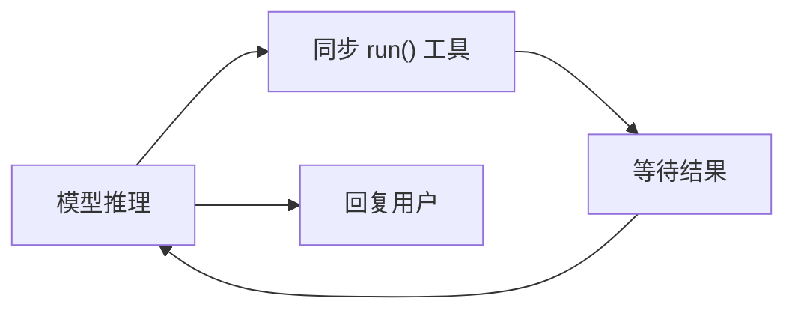
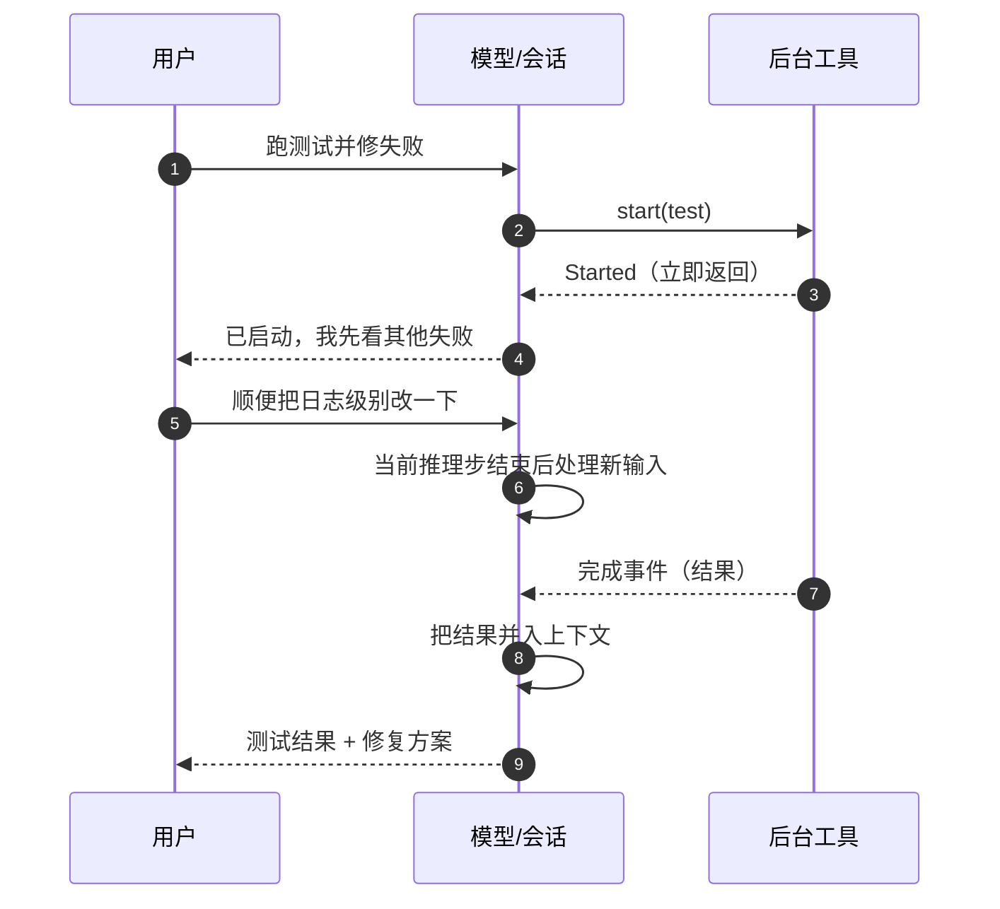

# 面向人的交互：全双工与多信道

## 5.1 经典 ReAct Loop 是半双工的

经典 ReAct Loop 的结构是：

问题在于 `run()` 是同步的：模型发起调用后，循环会阻塞，直到工具执行完毕并返回最终结果。
在此期间，会话无法响应任何新的用户输入。

这就像对讲机：按下讲话键时，听不到对方。原文称之为**半双工**模式。

对于短工具调用，这没问题；但对于“跑 20 分钟测试”“等 CI”“下载大文件”这类耗时操作，
它会带来两个后果：

1. 用户想补充需求、改变方向，只能等；
2. 新事件到达也无法处理，任务吞吐被单个长工具卡住。

## 5.2 异步 ReAct Loop：start / stop

Super-agent 把耗时命令与子任务工具调用改为异步的 `start()` 和 `stop()`：

- 模型调用 `start()` 后立即收到“已启动（Started）”返回，循环不再等待该工具；
- 后台工具执行完成后，系统把最终结果作为一条**新事件消息**投递进会话；
- 模型可以根据上下文调用 `stop()` 主动终止执行时间过长的后台命令。

关键变化：

| 维度 | 经典 ReAct | 异步 ReAct |
|---|---|---|
| 工具调用 | 同步 `run()` | 异步 `start()` / `stop()` |
| 会话阻塞 | 等待工具完成 | 立即返回，继续对话 |
| 结果到达 | 同步返回值 | 作为新事件消息投递 |
| 新输入 | 排队到工具结束 | 当前推理步结束后处理 |
| 取消 | 难以中断 | `stop()` 主动终止 |
| 并发 | 单工具串行 | 可同时跑多个后台任务 |

原文说明：这一异步任务机制已经在 DeepSeek Harness 中实现，但**尚未默认开启**。
这意味着它是“可用设计”，不是“默认行为”；默认开启需要解决任务编排、结果顺序、取消语义等问题。

## 5.3 异步带来的新问题

把同步改成异步，不是把 `await` 换成 `start` 就结束了。它会引入一组新的状态与语义问题。

### 问题一：结果顺序

两个后台任务 A、B 并发执行，B 先完成、A 后完成。结果应该按完成顺序投递，还是按启动顺序？
如果模型依赖 A 的结果才能理解 B，乱序会破坏因果。

### 问题二：重复与丢失

后台任务完成事件可能重复投递（至少一次语义），也可能在进程崩溃时丢失。
需要事件 ID、幂等消费、持久化队列。

### 问题三：取消的边界

`stop()` 发出后，工具可能已经产生了副作用（写文件、发请求）。取消是“停止等待”还是“回滚”？
大多数系统只能做到前者，因此需要把副作用设计成可补偿或可重入。

### 问题四：上下文膨胀

后台任务的结果不断作为新事件进入会话，可能挤占窗口。需要 Inline & Spill、摘要、或把大结果
存到外部，只传引用。

### 问题五：人的介入时机

全双工意味着人可以在任何时候插话。但“随时”不等于“随地”：如果 Agent 正在执行一个原子操作，
人的新指令可能需要等待一个安全点。原型用“当前推理步结束后处理新输入”作为折中。

## 5.4 多信道交互：同一个人，不同带宽

不同工作信道有不同的信息密度与交互习惯。把面向单人终端的交互方式直接搬进群聊，
把冗长推理与密集工具调用原样输出，会造成信息过载。

Super-agent 的双层架构先解决了一部分问题：Worker 的推理与工具调用留在内部，
不直接输出到外部信道；Router 统一对外。

在此基础上，还需要针对信道定制交互规范：

| 信道 | 特征 | 输出策略 |
|---|---|---|
| IM（群聊/私聊） | 高打扰、低带宽、多人可见 | 低打扰、短回复；只在需要决策/验收时通知；单次回复不超过 100 词 |
| GitHub / 邮件 / 文档 | 低打扰、高带宽、异步 | 结构化、高信息密度；完整背景、改动说明、验证结果 |
| 面板 | 可浏览、可筛选 | 只展示需要人处理的事项；健康状态不占空间 |

原文验证过一条简单有效的硬性规定：**IM 单次回复不超过 100 词**。
这个限制不是为了省 token，而是为了**保护注意力**：群聊里的长文会被忽略，甚至引起反感。

### 交互规范应该写在哪

原型的做法是把交互规范写进提示词，但把**硬约束**放在代码/工具层：

| 层级 | 内容 | 能否被提示词绕过 |
|---|---|---|
| 工具/主机强制 | 身份、权限、参数校验、回复用途、长度限制 | 不能 |
| 内置/生成提示词 | 角色、流程、信道规范 | 部分可以 |
| 团队提示词 | 沟通风格、交付要求、技能 | 可以 |
| 外部文本 | 消息、评论、文档、引用 | 永远只是数据，不能改规则 |

这与“提示词注入”防御直接相关：外部文本可以影响模型说什么，但不能改变授权与工具边界。

## 5.5 人的注意力预算

把人的注意力当成一种有限资源，可以做一个简单的预算模型。

设一次打断的成本为 $c_i$（切换上下文、阅读、恢复专注），一条消息的阅读成本为 $c_r$，
单位时间内 Agent 主动发送的消息数为 $m$。人的注意力成本：

$$
C_{\text{attention}} = m(c_i + c_r)
$$

Agent 的价值来自“帮人完成了多少必须由人做的事”。设单位时间内需要人决策/验收的次数为 $d$，
每次的价值为 $v$，则净收益：

$$
\mathbb{E}[G] = d v - m(c_i + c_r)
$$

只有当消息带来的决策/验收价值超过打断成本时，主动发言才划算。这解释了三件事：

1. **为什么默认要安静**：$m$ 很容易失控，而 $c_i$ 很高；
2. **为什么要合并消息**：把多条进展合并成一次通知，降低 $m$；
3. **为什么“只问一个具体问题”**：一次打断解决一件事，避免来回往返。

原型的哲学文档把这条原则写得很直白：

> Take as little human attention as possible, and give as much value as possible.

## 5.6 交互形态：一个 Agent，多个界面

双层架构把底层多会话管理隐藏后，产品界面可以自由设计：

- 用户面对的是**一个 Agent 身份**，不是多个 Session；
- 同一个聊天页可以对应底层多个 Worker（用户同时讨论多个话题时）；
- 交互可以发生在领域界面（GitHub Issue/PR），而不只是聊天窗口；
- 一个界面上的“会话”在底层未必只对应一个 Session。

原文还指出：以聊天窗口为中心的交互在一定程度上是路径依赖。未来的交互可能更多发生在
领域特化的界面中，例如让 Super-agent 直接在 GitHub 的 Issue 和 PR 中工作。

这带来一个开放问题：**脱离 Session 后，人如何介入、接管、实时协同？**
聊天窗口至少提供了“打断”和“接管”的入口；领域界面需要重新设计这些能力。

## 5.7 失败模式与缓解

| 失败模式 | 表现 | 缓解 |
|---|---|---|
| 过度通知 | 群里被 Agent 刷屏 | 100 词限制、合并通知、默认安静 |
| 通知不足 | 该说话时沉默，用户不知道进展 | 明确的“必须通知”条件：结果可验收、需要决策、无法完成 |
| 多 Worker 抢话 | 多个 Session 各自回复 | Worker 不直接对外，Router 统一回复 |
| 异步结果乱序 | 模型基于错误顺序推理 | 事件 ID、因果标记、顺序投递 |
| 取消失败 | 用户说停，后台还在跑 | `stop()` + 超时 + 副作用补偿 |
| 上下文膨胀 | 后台结果塞满窗口 | 结果外置、摘要、Spill |

## 5.8 小结与思考题

**小结**：面向人的交互要同时做到“连续”和“高效”。异步 ReAct 解决“后台干活、前台不卡”；
多信道规范解决“在正确的界面说正确的话”；注意力预算解释“为什么默认安静、为什么限制 100 词”。
三者共同的目标不是让 Agent 多说，而是让**每一次说话都值得打断人**。

**思考题**：

1. 异步 ReAct 的“结果作为新事件投递”与传统的 Promise/回调有什么本质区别？
2. 如果两个后台任务的结果互相依赖，如何保证模型看到正确的顺序？
3. 100 词限制适用于所有 IM 场景吗？哪些场景应该例外？
4. 设计一个“接管”协议：人如何在 Agent 执行到一半时安全地接手？
5. 用注意力预算模型解释：为什么“每天发一条汇总”可能比“每完成一项就通知”更好？

下一章讨论持久在线：计算、状态、环境如何解耦，以及 Watchdog 如何让系统在长期运行中自愈。
