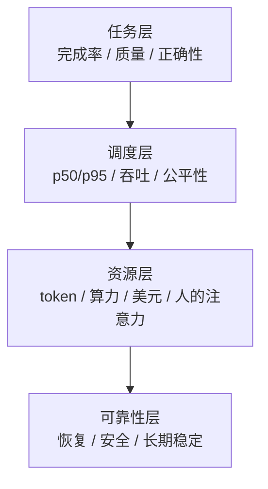

# 实验：数字说明了什么

> 本章数字均来自 DeepSeek Harness 2026 原文第 7 节。实验基于合成负载与简化环境，
> 作者自己声明“仅作初步参考”。本章的重点不是记住数字，而是理解每个数字对应哪个机制、
> 以及它没有证明什么。

## 8.1 实验设置

### 端到端消融

| 项目 | 设置 |
|---|---|
| 负载 | 群聊 + GitHub CI 消息流 |
| 单次规模 | 约 300 条消息，其中约 20 条是工作请求 |
| 其余消息 | 闲聊、跟进、叫停、CI 消息 |
| 编码工作 | 用一个“只消耗时间”的工具代替 |
| 重复次数 | 每种方案 5 次 |
| 时间缩放 | 消息间隔与工作时长按 1/4 缩放；模型调用耗时为真实值 |

对比四种方案：

1. **Super-agent**：完整双层 + 订阅直通；
2. **去掉直通的 Super-agent**：后续事件仍经过 Router；
3. **单 Session + Subagent（中性提示）**：
   “Use a subagent for a piece of work when appropriate...”；
4. **单 Session + Subagent（优先委派提示）**：
   “Every message of the chat reaches you... Prefer handing each piece of work to a subagent...”

### Router 压测

| 项目 | 设置 |
|---|---|
| Router | 真实模型 |
| Worker | Mock 模型 |
| Trigger 到达率 | 从约 1 条/分钟升至约 40 条/分钟 |
| 观测指标 | 平均 batch 大小、单次请求耗时、单个决定分摊推理时间 |

## 8.2 端到端结果

任务完成时间定义为“从工作请求到结果消息”的耗时。

| 方案 | p50 | p95 | 备注 |
|---|---:|---:|---|
| Super-agent | 12.4 min | 15.7 min | 完整双层 + 直通 |
| 去掉直通的 Super-agent | 基本一致 | 基本一致 | Router 决定数 +30%；读缓存 token 23.23M → 31.77M |
| 单 Session + Subagent（中性提示） | 未给出 | 29.5 min | 5 次运行中 0 次调用 Subagent |
| 单 Session + Subagent（优先委派） | 未给出 | 慢于 Super-agent | 5 次中 4 次委派；1 次自执行形成长尾 |

原文的关键结论：

- Super-agent 的 p50/p95 显著优于带 Subagent 的单 Session；
- 单 Session 方案受提示词影响很大：中性提示下模型完全不委派，所有工作都在主 Session 里做，
  被新消息不断打断，p95 达到 29.5 分钟；
- 优先委派提示能改善，但仍慢于 Super-agent，且存在“模型判断工作很小而自己执行”的长尾；
- 去掉直通后完成时间基本一致，但 Router 决定数增加约 30%，读缓存 token 增加约 37%。

### 怎么读这些数字

**p50 = 12.4 分钟**：一半的工作请求在 12.4 分钟内完成。
**p95 = 15.7 分钟**：95% 的工作请求在 15.7 分钟内完成。
两者差距不大，说明 Super-agent 的完成时间分布较集中，尾部不长。

对比单 Session 的 p95 = 29.5 分钟：尾部明显更长，原因是主 Session 被新消息打断，
工作被反复推迟。

**注意**：由于消息间隔与工作时长按 1/4 缩放，12.4 分钟不是真实场景的墙钟时间，
而是缩放后的实验时间。不要把绝对值当作产品 SLA。

### 直通机制的价值

去掉直通后：

- 完成时间几乎不变；
- Router 决定数 +30%；
- 读缓存 token 从 23.23M 增至 31.77M。

这说明直通机制**不提升速度**，但**显著降低 Router 的负载与 token 开销**。
它的价值是“省资源、留余量”，而不是“让任务更快”。

用比值表示 token 开销：

$$
\frac{31.77}{23.23} \approx 1.368
$$

即增加约 36.8%，与原文“约 37%”一致。

## 8.3 Router 压测结果

| 指标 | 低负载（约 1 条/分钟） | 高负载（约 40 条/分钟） |
|---|---:|---:|
| 平均 batch 大小 | 1.0 | 2.8 |
| 单次请求耗时 | 2.5 s | 3.9 s |
| 单个决定分摊推理时间 | 6.4 s | 1.6 s |

解读：

- 到达率提高约 40 倍，单次请求耗时只从 2.5 s 增至 3.9 s（约 1.56 倍）；
- 请求耗时的增长远慢于 batch 大小的增长，说明 Prefill 阶段并行计算有效；
- 分摊到每个决定的时间下降，说明突发拥堵时 Router 能通过合并积压事件提高有效吞吐；
- 这也解释了为什么去掉直通后峰值负载增加，仍未触及单 Router 的吞吐瓶颈。

### 分摊时间的计算与注意

按“单次请求耗时 / batch 大小”粗算：

$$
A(1) = 2.5/1 = 2.5\text{ s}
$$

$$
A(2.8) \approx 3.9/2.8 \approx 1.39\text{ s}
$$

原文报告的是 $6.4 \rightarrow 1.6$ s。两者同量级，但不完全一致。可能的解释：

- 6.4 s 包含排队、调度、上下文组装等端到端开销，不只是 LLM 请求耗时；
- “单个决定分摊”可能按一轮内实际处理的 Trigger 数计算，而不是平均 batch 大小；
- 原文没有给出完整的指标定义与分解。

因此，**6.4 → 1.6 应理解为“高负载下每个决定的有效分摊时间改善”，而不是纯推理加速比**。
如果用它来推算单卡吞吐或成本，会得到过于乐观的结论。

## 8.4 这些实验证明了什么

| 结论 | 证据强度 | 说明 |
|---|---|---|
| 双层架构在多任务合成负载下完成时间更短、尾部更稳 | 中 | 5 次运行，合成负载，但对比清晰 |
| 订阅直通能显著降低 Router 的 token 与决策开销 | 中 | 同一负载下的消融，方向明确 |
| Router 批处理能提高突发负载下的有效吞吐 | 中 | 真实模型 + Mock Worker，压测范围有限 |
| 单 Session + Subagent 的行为对提示词高度敏感 | 强 | 0/5 vs 4/5 的委派率差异非常直观 |
| Super-agent 的任务质量更高 | **未证明** | 编码工作被替换为“只消耗时间”的工具 |
| Super-agent 在真实生产负载下更优 | **未证明** | 合成负载、简化环境、时间缩放 |
| Super-agent 更便宜 | **未证明** | 只报告读缓存 token，没有总成本/美元 |
| Super-agent 能长期稳定运行 | **未证明** | 实验时长有限，未覆盖跨月、故障注入、安全攻击 |

## 8.5 实验设计的局限

### 1. 合成负载

消息流是合成的，工作请求比例、到达分布、任务时长都由实验者设定。
真实群聊/CI 的突发性、长尾、重复请求、噪声比例可能完全不同。

### 2. 工作被替换为 sleep 工具

“编码工作用一个只消耗时间的工具代替”，意味着实验衡量的是**调度与协作能力**，
不是**任务执行质量**。Super-agent 可能调度更快，但代码质量是否更好，实验没有回答。

### 3. 时间缩放

消息间隔与工作时长按 1/4 缩放，模型调用耗时为真实值。这会让“计算时间”在总时间中的占比
高于真实场景，可能放大或缩小某些瓶颈。绝对时间不可直接外推。

### 4. 重复次数少

每种方案 5 次，没有置信区间、显著性检验。对于高方差任务，5 次不足以稳定估计 p95。
原文用“初步参考”是诚实的。

### 5. 单一环境

没有跨模型、跨团队规模、跨任务类型的对比。Router 用轻量模型是否足够，取决于具体模型与任务分布。

### 6. 缺少安全与故障注入

没有提示词注入、凭据泄露、Worker 失控、网络分区、数据库故障等测试。
持久在线系统的很多问题只在长期运行与对抗环境中暴露。

## 8.6 如果重做实验，应该加什么

| 维度 | 建议 |
|---|---|
| 任务质量 | 用真实编码任务 + 测试通过率/人工评审，而不是 sleep 工具 |
| 负载真实性 | 回放真实 IM/CI 事件轨迹，保留原始时间分布 |
| 规模 | 扫描任务数、并发 Worker 数、Router 分片数 |
| 成本 | 记录输入/输出/缓存 token、模型调用次数、美元成本 |
| 尾部 | 增加重复次数，报告 p50/p90/p95/p99 与置信区间 |
| 长期运行 | 数天/数周的持续负载，注入进程崩溃、网络故障、模型限流 |
| 安全 | 提示词注入红队、凭据访问测试、越权尝试 |
| 消融 | 单独关闭批处理、订阅、链式召回、投机执行，量化各自贡献 |
| 人因 | 测量人的打断次数、决策时间、主观负担，而不只是任务完成时间 |

## 8.7 一个更完整的评价框架

评价 Super-agent，至少要看四层：

只报告调度层（完成时间）和资源层（token），会得出片面结论。
一个系统可能“更快但更贵”“更自主但更容易越权”“更稳定但更难调试”。

## 8.8 小结与思考题

**小结**：实验最有说服力的部分是**消融对比**：直通机制省 token 但不提速；单 Session 的委派行为
高度依赖提示词；Router 批处理能在突发负载下摊薄单决定成本。最没有被证明的部分是**任务质量、
真实负载、长期可靠性与安全性**。读实验时，先看“它度量了什么”，再看“它没有度量什么”。

**思考题**：

1. 为什么“完成时间更短”不能直接推出“生产力更高”？
2. 如果 p50 很好但 p99 很差，用户体验会怎样？应该优化哪个指标？
3. 设计一个实验，单独量化“链式召回”对长程任务成功率的贡献。
4. 去掉直通会让读缓存 token 增加 37%；在什么负载规模下，直通机制最值得投入？
5. 如果让你用一天时间复现这个实验，你会优先复现哪一组对比？为什么？

下一章把 Super-agent 放回 Agent 技术版图，与 Agent Team、Anthropic Managed Agents、
A2A、工作流引擎做对比。
