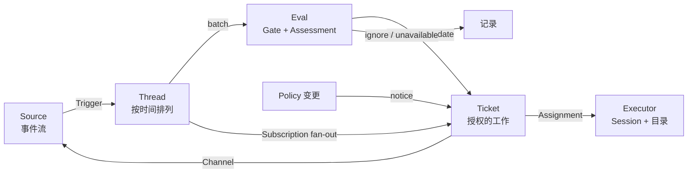
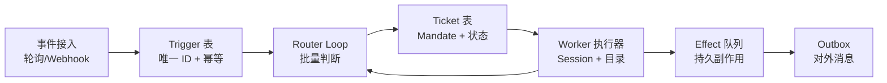

# 原型实现：dsh-superagent

> 本章依据官方仓库 `deepseek-ai/dsh-superagent-prototype` 的 README 与 `docs/000-008`。
> 它是研究原型，不是生产软件；部分文章中的设计并未在原型中实现。

## 7.1 它是什么

一句话：

> 一个面向**单个 GitHub 仓库**的主动式 Coding Agent，打包为 DeepSeek Harness 的插件。

行为链路：

1. 监听 GitHub（可选 Feishu）；
2. 当被允许的人请求工作时，打开一个 work item（Ticket）；
3. 在独立的 Agent Session 和目录中工作；
4. 在原始对话中答复，例如提交一个 Pull Request；
5. Web 面板展示“哪些事需要人”。

它的哲学不是“尽可能多做事”，而是：

> **占用尽可能少的人类注意力，提供尽可能多的价值。**

这直接决定了后面的授权模型、回复规范与“默认安静”的策略。

## 7.2 领域模型

原型的领域模型比文章更具体。核心流程：



| 概念 | 定义 | 关键规则 |
|---|---|---|
| Source | 事件流；一种可复用实现 + 一个实例配置 | 保存读位置；丢弃自己的 bot 消息；重启不重放 |
| Trigger | 一条不可变事件，带 Source 元数据 | 属于一个或多个 Thread；重复 accept 只创建一个 Ticket |
| Thread | 按时间排列的 Trigger 流 | 同一 Thread 同时只跑一个 Eval；可有多个 Ticket |
| Correlation | 一个 Trigger 所属多个 Thread 时的关联 | 只增加上下文，绝不路由 |
| Channel | Thread 的写侧 | 一个 Thread 可有多个 Channel；Ticket 持有一组 |
| Policy | 版本化的准入规则与各 Source 的配置 | 规则、accept mode、Source 部分共同构成版本 |
| Eval | 对一批 Trigger 的判断，分 Gate 与 Assessment | 无状态；输入是 batch、Thread 快照、Ticket 列表、Policy |
| Decision | Eval 的输出 | `accept` / `stop` / `ignore` / `unavailable` |
| Mandate | accept 授予的内容 | 不可变；范围变大要新 Ticket；只有人的 stop 能撤回 |
| Ticket | 一个被授权的工作单元 | 只有 Eval 能创建；自己定义状态，不跟随 Executor |
| Assignment | Ticket 与一个 Executor 实例的绑定 | pending → running → ended，独立于 Ticket |
| Subscription | Ticket 与 Thread 的多对多订阅 | 匹配的 Trigger 扇出给所有存活订阅者，不检查发送者 |
| Executor | 执行 Assignment 的端口 | 一个 Executor Session + 每个 Ticket 一个目录 |

几个容易忽略的规则：

- **一个 Thread 可以有多个 Ticket**：同一话题下可以有多件独立工作。
- **一个 Ticket 可以有多个 Assignment**：Executor 可能重启、重试、换实例。
- **结束的 Ticket 仍保留 Subscription**：人后续在 Thread 里留言，可以在同一 Mandate 下恢复，
  不需要重新 Eval；但 bot 和 CI 消息不会唤醒它。
- **被人工 stop 的 Ticket 不再接收任何消息**：要重新开始，必须新的 accept。

## 7.3 一次请求的授权路径

原型把“谁可以发起工作”与“上下文如何流动”分得很开。

### 两条路径

| 路径 | 触发条件 | 是否经过 Eval | 是否授予新授权 |
|---|---|---|---|
| Eval | 新事件、未被 Ticket 接管的评论 | 是 | 可能（accept 创建 Mandate） |
| Subscription fan-out | 已订阅 Thread 上的后续事件 | 否 | 否，只作为上下文 |

这解决了两个问题：

1. **连续性**：已分配任务的后续消息直接到达 Worker，不必重新判断；
2. **安全**：看到消息不等于获得授权，Ticket 仍受原 Mandate 限制。

### 显式 vs 推断

| 强度 | 典型情况 |
|---|---|
| `explicit` | 白名单内的人明确 @ Agent 或直接消息；已有 Ticket 的 Thread 上的人后续消息；准入表中设为“明确请求”的格子 |
| `inferred` | 白名单外的人在已有 Ticket 的 Thread 上后续；准入表中设为“候选”的格子；白名单 bot 的消息 |
| `not admitted` | 其他 bot；准入表忽略；`off` 模式下的所有推断 |

关键规则：

- bot 永远不能产生 `explicit` 请求；
- 自动审查机器人如果用普通账号，会被当成“人”；
- 外部文本（消息、评论、引用文档）永远不能改变策略或授权。

### 三种 accept mode

| 模式 | 行为 |
|---|---|
| `off` | 推断事件不成为候选 |
| `observe`（默认） | 推断事件会被评估，但正向结果只记录为“would accept”，不真正接单 |
| `auto` | 推断事件的正向评估可以真正接单 |

推荐路径：先在 `observe` 模式观察 Agent “本来会做什么”，确认行为符合预期后再切 `auto`。
这是把“主动”从不可控变成可审计的关键设计。

### Mandate 与 Policy 版本

Mandate 记录：

- Policy 版本；
- 工作范围（scope）；
- 强度（explicit/inferred）；
- 匹配的规则；
- 发送者在该 Source 上的身份；
- Source 如何收到这条 Trigger。

规则：

- Mandate 不可变；范围变大要创建新 Ticket；
- 只有人的 stop 能撤回 Mandate；
- Policy 不再成立时，Mandate 会被撤销；
- 恢复已结束的 Ticket 前，要按当前 Policy 重新验证。

Policy 变更时：

- 丢弃正在运行的 Eval，重新排队；
- 给受影响的存活 Ticket 发送 `policy-changed` 输入；
- **不会立即撤销**存活 Ticket 的 Mandate，但会在恢复时重新验证。

这避免了“规则一改，正在做的工作被腰斩”，同时保证新工作按新规则执行。

## 7.4 Ticket 状态机

每个打开的 Ticket 有一个 stage，按表格从上到下匹配，第一条命中即生效：

| Stage | 条件 | 面板标签 |
|---|---|---|
| person / delivery | 向 Executor 投递 Input 失败，正在重试 | Input undelivered |
| person / answer | 有一个等待回答的问题（Attention） | Awaiting answer |
| person / review | 最新 Report 是 `ready` | Awaiting review |
| person / blocked, failed | 最新 Report 是 `blocked`/`failed`，且此后没有人发消息 | Blocked / Failed |
| working / queued | 没有 Assignment，或 Assignment 还是 pending | Queued |
| idle | 最新 Report 是 `waiting`，或 Assignment 已结束 | Waiting for a Trigger |
| working | 其他 | Working |

`person` 阶段意味着“没有人的输入就无法继续”。人的新消息会把 `blocked`/`failed` 的 Ticket
释放回 Executor，通常进入 `working`。

这个状态机的价值在于：**面板只需要展示“谁在等人”**，而不需要暴露底层 Session 细节。

## 7.5 执行模型

### Session 与目录

- 每个 Ticket 一个 Executor Session，命名为 `worker-<ticket id>`；
- 每个 Ticket 一个目录，目录名来自 Ticket 的短名；
- 目录创建在配置的执行根目录下，默认 `<stateDir>/work`。

### 工具预设

| 角色 | 预设 | 特点 |
|---|---|---|
| Main Session | `dsh-superagent-router` | 较小工具集；shell 5 秒后转后台；job wait ≤5 秒 |
| Executor | `dsh-superagent-worker` | 完整工作工具；shell 5 秒后转后台 |
| Worker 的 Subagent | `standard` | shell 60 秒后转后台；继承 Worker 权限 |

Executor 以操作系统的用户身份运行命令，不逐条审批。这是能力，也是风险；原型的包装器
（wrapper）只建立默认值，不是安全边界，Worker 仍可以通过绝对路径执行程序。

### 后台工作与 Slot

- 一个 turn 结束时如果还有 shell job 或 subagent 在跑，Ticket 保留 Worker Slot，状态仍是 working；
- 后台任务完成后，会在同一个 Slot 唤醒 Executor；
- 每个 turn 结束后，后台工作最多 30 分钟；到时限后 shell job 被杀，Ticket 报告 waiting；
  subagent 允许继续；
- 交接给人（handoff）会立即释放 Slot；subagent 停止，shell job 可继续但不占 Slot。

### 并发与人的优先级

- Slot 从 launch（含 prepare）或唤醒 idle Executor 的 delivery 开始占用，贯穿整个 active turn；
- 配置的并发上限约束 Slot；
- **人的消息或状态查询可以额外占一个 Slot**；
- 人的唤醒优先于新任务启动；
- 其他 Input（如 CI 结果）等待正常 Slot。

这保证了人不会被自己创建的 Agent 饿死。

### 恢复

| 场景 | 行为 |
|---|---|
| 瞬时模型/网络故障 | 重试 3 次，指数退避 |
| launch 失败 | 非瞬时故障则 Ticket 失败 |
| 运行中宿主重启 | Assignment 以“host restarted”结束，新 Assignment 带恢复说明启动 |
| 人 stop | 取消当前 turn；Ticket 结束，不再接收消息 |
| retry | 在同一个 Session、目录、分支、PR 上启动新 Assignment |

恢复时，Executor 被要求先检查目录、git 历史和 GitHub，再重复任何外部动作。
已投递但未读的 Input 会保留；已读的不会重复投递。这依赖原型显式的“读回执”机制。

## 7.6 可靠性结构

原型在代码结构上体现了“单一写者 + 持久副作用”的原则。

### 单一写者

| 状态 | Writer |
|---|---|
| Trigger / Thread / Decision / Ticket / Assignment | `Engine` |
| Source 读位置、Thread 元数据 | 对应 Source |
| Settings 及历史 | `Settings` |
| Prompt 版本 | `Prompts` |
| Effect 队列 | `Effects` |
| 对外消息收据 | `Outbox` |
| 健康检查项 | 认领它的组件 |

`Engine` 的方法是同步的，每个命令在一个事务里修改聚合；跨多个部分的命令按顺序调用。
外部工作通过 Port 在事务内入队，提交后由适配器执行。

### 持久副作用队列

`Effects` 是一个持久化队列：

- 命令在事务内 `enqueue(kind, key, payload)`；
- 事务提交后才开始执行；
- 每个 `kind/key` 只有一行；
- 失败按指数退避重试；
- `Later` 可以延迟而不计失败（例如没有空闲 Worker Slot）。

Effect 种类包括：`assessment`、`launch`、`delivery`、`relay`、`notice`、`reply`。

### Outbox

`Outbox` 是唯一写消息收据的地方：

- `send` 在一个事务里保存收据并排队 `reply` effect；
- effect 通过 `SourceRegistry.send` 真正发送；
- 同一个 Ticket 到同一个会话的消息保持顺序；
- 发送失败重试（5 秒起，翻倍到 300 秒）；
- 只有在 Source 不再监听该会话，或明确知道会话永远收不到时，才丢弃消息。

这避免了“消息发了但没记录”或“记录发了但实际没发”的不一致。

## 7.7 提示词与工具边界

原型把“角色职责”写进了提示词，但把“硬约束”放在代码/工具层。

### Main Session（Router）

- 只做评估与路由，不做技术决策；
- 通过一个路由工具，一次调用处理多个候选的 accept/attach/stop/ignore；
- 路由备注最多 30 词；
- 不允许 `sleep`、超过 30 秒的 shell timeout、超过 5 秒的 job wait；
- 没有剩余工作时结束 turn，不等待报告；
- 报告、后续通知、候选、后台任务完成会自动作为消息到达。

### Executor（Worker）

- 拥有 Ticket 目录内的技术工作：读上下文、判断范围、选择方案、验证结果；
- 使用 `gh` 做所有 GitHub 操作；
- 不直接 merge；auto-merge 也只在交付要求允许时开启。默认规则允许对“本 Ticket 打开的 PR、
  已就绪、审批覆盖 head commit、增删少于 200 行”的情况开启 auto-merge；
- 完成时调用 `orchestrator_report`，区分“完成”和“未完成草稿”；
- 工具集中排除 `ask_user_question`、`present`、`plugin_manager` 等需要直接面对人的工具；
- 通过结构化的 `human_action` 字段提出一个问题，由 Router 转发。

### 通信规范

- 聊天消息默认一句话，硬上限 100 词；
- 新请求先确认一次，说明对象与预期结果；
- 只在“人必须行动”或“结果可被使用”时发言；
- 一个 `human_action` 只问一个具体问题；
- 示例只展示格式，不是 Agent 可以声称的事实。

## 7.8 代码地图

| 模块 | 职责 |
|---|---|
| `src/core/engine.ts` | 领域聚合的唯一写者；命令与事务边界 |
| `src/core/ports.ts` | Repository、Policy、SourceScope、Assessor、Executor、Outbox 等端口 |
| `src/core/model.ts` | 领域类型与共享谓词（`waitsForPerson`、`followupOwners`、`settled`） |
| `src/core/stage.ts` | Ticket stage 表 |
| `src/policy.ts` | 设置 schema、授权、评估规则、Policy 版本 |
| `src/app/store.ts` | 单个 SQLite 数据库；仓储、读查询、设置、收据 |
| `src/app/effects.ts` | 持久副作用队列；重试与并发控制 |
| `src/app/outbox.ts` | 消息收据与发送顺序 |
| `src/executor/dsh.ts` | 每个 Ticket 一个 Session + 目录；launch/delivery/retry/resume |
| `src/app/assessment.ts` | 主 Session 的候选评估；上下文、读取、决策 |
| `src/sources/github*.ts`、`feishu*.ts` | 外部事件 → Trigger/Thread/Channel |
| `src/app/tools/main.ts`、`executor.ts` | 工具参数 → 领域命令；结果 → 卡片 |
| `src/app/notices.ts` | 领域事件/Worker 报告 → 主 Session 通知 |

依赖规则：

- `src/core` 不导入自身之外的模块，不做 I/O；
- `src/sources` 不导入 `src/app`；
- 每类状态只有一个 writer；
- 请求用祈使动词（`stopTicket`），事实用过去式（`assignmentStarted`）；
- 每个角色只拿到 Engine 的一个 `Pick`，看不到不属于自己的方法。

## 7.9 原型与文章设计的差异

原型 README 明确说明：

- 为公开发布做过适配，不等同于内部版本，也不等同于文章描述的实现；
- 文章中的一些设计是未来方向，原型没有实现；
- 原型只面向单个 GitHub 仓库，GitHub + Feishu 两种 Source；
- 它是研究代码，可能有 bug，工程风格可能不一致。

因此，读原型时要区分：

| 类别 | 例子 |
|---|---|
| 文章 + 原型都实现 | 双层角色、触发/工单、授权、订阅、持久副作用、恢复 |
| 文章有、原型简化 | 多信道全双工、复杂投机执行、跨设备 BYOM、完整 Watchdog |
| 仅文章讨论 | 大规模 Router 分片、A2A、跨组织上下文边界 |

## 7.10 如果从零实现，最小可行路径

本节是本书的建议，不是原文内容。目标是用最小系统验证“双层 + 授权 + 持久化”是否成立，
而不是一上来就做完整产品。

### 五个必要组件



| 组件 | 最小实现 | 先不要做 |
|---|---|---|
| 事件接入 | 一个 Source，轮询或 Webhook，落库去重 | 多平台、复杂连接器 |
| Trigger 表 | SQLite，唯一 ID，disposition | 分布式消息队列 |
| Router Loop | 单进程定时循环，批量取待处理 Trigger，调用模型 | 多级 Router、分片 |
| Ticket | 状态机 + Mandate（范围、强度、策略版本） | 复杂项目管理 |
| Worker | 每个 Ticket 一个 Session + 一个目录 | 容器编排、跨设备 |
| Effect 队列 | 同库一张表，事务内入队、提交后执行、失败重试 | 独立消息中间件 |
| Outbox | 消息收据 + 顺序发送 | 多租户网关 |

### 一个 Router Loop 的伪代码

```python
while running:
    batch = store.claim_due_triggers(limit=BATCH_MAX)
    if not batch:
        sleep(POLL_INTERVAL)
        continue

    # 同一 Thread 的 Trigger 合并；不同 Thread 可以并行
    groups = group_by_primary_thread(batch)
    for thread, triggers in groups.items():
        context = build_context(thread, triggers, store)
        decision = llm(ROUTER_PROMPT, context, policy=current_policy)

        for item in decision.items:
            if item.outcome == "accept":
                ticket = store.create_ticket(
                    trigger=item.trigger,
                    mandate=Mandate(scope=item.scope,
                                    strength=item.strength,
                                    policy_version=current_policy.version),
                )
                effects.enqueue("launch", ticket.id, ticket)
            elif item.outcome == "ignore":
                store.record_decision(item, reason=item.reason)
```

关键约束：

- `claim_due_triggers` 要保证同一 Trigger 不会被两个循环同时处理；
- `create_ticket` 要幂等（同一 Trigger 重复 accept 只创建一次）；
- `effects.enqueue` 必须与业务状态在同一事务；
- `launch` 失败可重试，Worker 启动后要能读回已持久化的 Mandate 与输入。

### 落地顺序

1. **先做单任务闭环**：一个 Source、一个 Router、一个 Worker、一个 Outbox。
2. **加授权**：先只支持显式请求，再引入 `observe` 模式记录推断行为。
3. **加持久化**：Trigger/Ticket/Effect/Outbox 落库，做崩溃恢复演练。
4. **加事件直通**：订阅 Thread，后续事件绕过 Router。
5. **加 Watchdog**：先做进程存活与任务超时，再做“是否有实质进展”的语义判断。
6. **最后再考虑**：多 Router 分片、A2A、跨设备 BYOM、复杂投机执行。

### 不要过早做的事

- 不要一开始就上 Kubernetes/微服务：单进程 + SQLite 足以验证核心假设；
- 不要一开始就做多级 Router：先测量单 Router 的批处理上限；
- 不要一开始就做向量数据库：先用 ID 引用与结构化查询；
- 不要一开始就追求“恰好一次”：先做“至少一次 + 幂等”；
- 不要把安全寄托在提示词上：授权与凭据边界必须在代码/基础设施层。

## 7.11 小结与思考题

**小结**：原型把 Super-agent 的抽象落成了可审计的领域模型：Source → Trigger → Thread → Eval →
Ticket/Mandate → Assignment → Executor → Report → Channel。它的工程价值不在于代码量，而在于
把“授权、幂等、恢复、单一写者、持久副作用”这些系统约束显式化。

**思考题**：

1. 为什么“Correlation 只增加上下文，不路由”是一条安全规则，而不只是建模选择？
2. 如果去掉 Mandate，只保留 Ticket，会发生什么授权问题？
3. 为什么 Effect 队列要在事务内入队、提交后执行？直接执行会怎样？
4. Ticket stage 表中，为什么 `person` 阶段优先于 `working`？
5. 原型只支持单个 GitHub 仓库，扩展到多仓库需要改哪些领域概念？

下一章解读实验：这些数字到底证明了什么，又没有证明什么。
