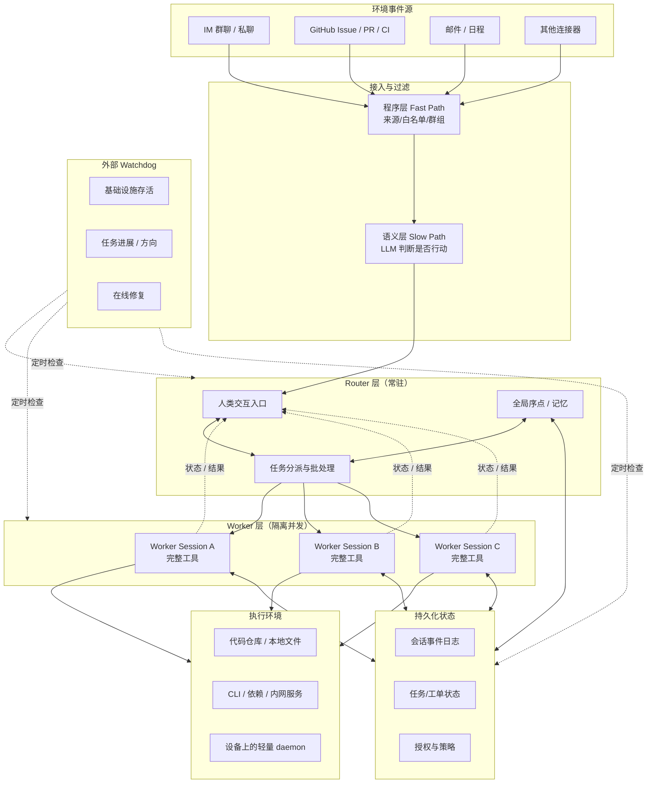
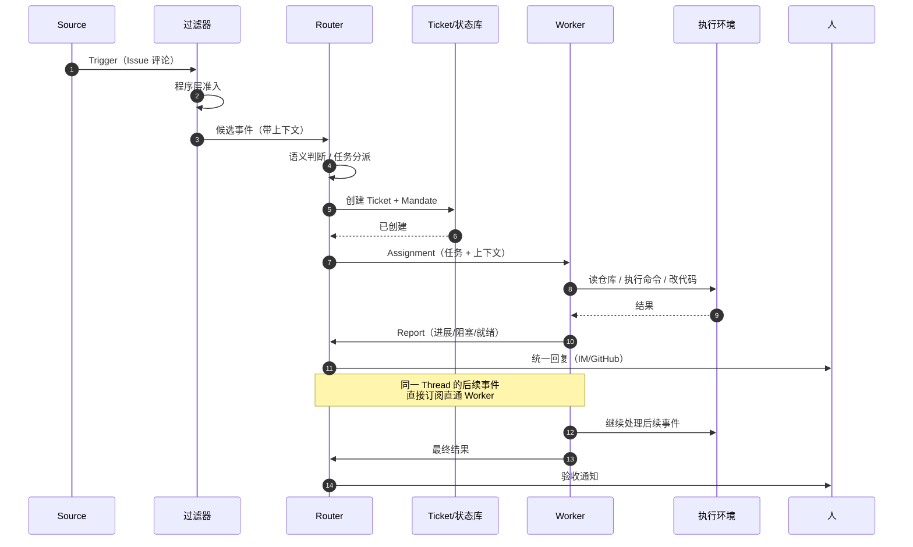

# 架构总览：四个特征，五个模块

## 2.1 一张图看清系统

Super-agent 的整体架构可以概括为：**两层、一个事件入口、一个状态/执行底座、一个外部看门狗。**

这张图里有三个容易混淆的点，先澄清：

1. **Router 不执行具体任务。** 它只做交互、记忆与分派，甚至可以不配 Bash 工具。
2. **Worker 不直接对外说话。** 它的推理与工具调用留在内部，结果汇报给 Router，由 Router 统一回复。
3. **Watchdog 不在主系统内部。** 它是一个独立的 Agent Session，用定时消息驱动，构成外部控制回路。

## 2.2 五个模块与四个特征的映射

| 模块 | 主要支撑的特征 | 核心问题 | 关键机制 |
|---|---|---|---|
| 双层架构 | 连续 + 高效 | 连续性与吞吐量如何兼得 | Router/Worker 分层、批处理、订阅直通 |
| 事件驱动 | 主动 | Agent 如何不等指令就行动 | Trigger/Thread、两级过滤、投机执行 |
| 面向人的交互 | 连续 + 高效 | 如何不阻塞、不打扰、不混淆 | 异步 ReAct、全双工、多信道规范 |
| 计算/状态/环境分离 | 持久 | 设备离线/崩溃后如何继续 | 无状态计算、持久会话日志、端侧 daemon、BYOM |
| 外部 Watchdog | 持久 | 长期运行如何自愈 | 外部 Control Loop、基础设施 + 任务进展监控 |

映射不是一一对应的：**连续**由双层架构与交互共同支撑；**持久**由存算分离与 Watchdog 共同支撑。
这说明 Super-agent 不是“一个特征一个功能”，而是多组机制协同。

## 2.3 一次任务的完整生命周期

以“有人在 GitHub 提了一个需求”为例：

关键状态转换：

1. **Trigger 入库**：不可变事件，带来源元数据；重复接收要幂等。
2. **Eval**：判断“是否开启新工作”，输出 accept / stop / ignore / unavailable。
3. **Ticket + Mandate**：Ticket 是授权的工作单元；Mandate 记录“为什么可以做、能做到什么范围”。
4. **Assignment**：把 Ticket 绑定到一个 Executor 实例；Executor 可能换、可能重启。
5. **Report**：Worker 汇报状态；只有最终报告才能从 Executor 侧结束 Ticket。
6. **Channel 回复**：所有对外消息通过 Router/Outbox 统一发送，保证顺序与去重。

## 2.4 六个设计原则

从原文与原型实现中，可以抽出六条反复出现的原则。

### 原则一：关注点分离，而不是功能堆叠

- 交互与执行分离（Router/Worker）；
- 计算与状态分离（无状态 harness / 持久日志）；
- 状态与环境分离（云端 Loop / 端侧 daemon）；
- 授权与上下文分离（Mandate / Subscription）。

每一刀都切在“变化频率不同”或“故障域不同”的边界上。

### 原则二：Fast Path / Slow Path

确定性的、高频的判断用代码走 Fast Path；需要语义理解的、低频的判断交给模型走 Slow Path。
事件过滤与事件路由都用了这个模式。

### 原则三：单一写者

原型中每类状态只有一个 writer：

| 状态 | Writer |
|---|---|
| Trigger / Thread / Decision / Ticket / Assignment | Engine |
| Source 读位置与 Thread 元数据 | 对应 Source |
| Settings | Settings |
| Prompt 版本 | Prompts |
| 副作用队列 | Effects |
| 对外消息收据 | Outbox |

单一写者让并发控制、审计与恢复都变简单。

### 原则四：局部性

上下文窗口被当作 Cache 管理：近期高概率用到的信息 Inline，低频/超预算的信息 Spill，
通过 ID 引用按需召回。这直接借用了计算机系统的局部性思想。

### 原则五：持久化副作用，而不是“先做再记”

任何跨边界动作（发消息、启动 Worker、投递输入）都先写入持久队列，事务提交后再执行；
失败可重试，进程崩溃可恢复。这是“至少一次 + 幂等”的经典组合。

### 原则六：外部监督

主系统很难仅靠内部逻辑保证长期可靠。Watchdog 放在主系统之外，既看进程存活，也看任务是否
有实质进展、是否偏离目标。它本身也是一个可对话、可修改系统行为的 Agent。

## 2.5 系统边界与部署形态

原文讨论的部署形态至少有两种：

| 形态 | 计算 | 状态 | 执行环境 | 典型场景 |
|---|---|---|---|---|
| 云端托管 | 云端无状态容器 | 云端数据库 | 云端沙箱/按需创建 | 团队共享、云端仓库 |
| BYOM | 云端无状态容器 | 云端数据库 | 用户自己的开发机/个人电脑 | 个人助手、本地未提交修改 |

BYOM（Bring Your Own Machine）是关键差异点：执行环境不跟着 Agent Loop 上云，
端侧只放一个不保存会话状态的轻量 daemon，负责执行命令、返回结果。
这样既能接入真实环境，又避免复制环境带来的成本与遗漏。

## 2.6 最小术语集

后文会反复使用这些词，先给出最短定义，完整表见[术语表](../appendix/glossary.md)。

| 术语 | 最短定义 |
|---|---|
| Trigger | 环境中的一条不可变事件 |
| Thread | 同一话题/PR/邮件串下按时间排列的 Trigger 流 |
| Router | 常驻的全局交互、记忆与分派层 |
| Worker | 上下文隔离、执行具体任务的会话 |
| Eval | 判断一批 Trigger 是否开启新工作的过程 |
| Ticket | 一个被授权的工作单元 |
| Mandate | 授权的内容：范围、强度、依据的策略版本 |
| Assignment | Ticket 与一个 Executor 实例的绑定 |
| Subscription | Ticket 与 Thread 的多对多订阅关系 |
| Watchdog | 主系统之外的控制回路 |

## 2.7 小结与思考题

**小结**：Super-agent 的架构可以压缩成“两层 + 事件入口 + 状态/执行底座 + 外部看门狗”。
它的设计语言大量借自操作系统与分布式系统：调度、缓存、快慢路径、投机执行、存算分离、看门狗。
理解这些类比，比记住模块名更重要。

**思考题**：

1. 为什么“Worker 不直接回复用户”能同时改善并发与交互质量？
2. 如果把 Watchdog 放进主系统内部，会失去什么？
3. 六个设计原则中，哪一条最难在原型规模之外保持？为什么？
4. 画出你所在团队的一个真实工作流，标出哪些步骤适合 Fast Path，哪些必须 Slow Path。

接下来三章分别展开双层调度、事件驱动、交互与持久化。先看最核心的 Router/Worker 拆分。
