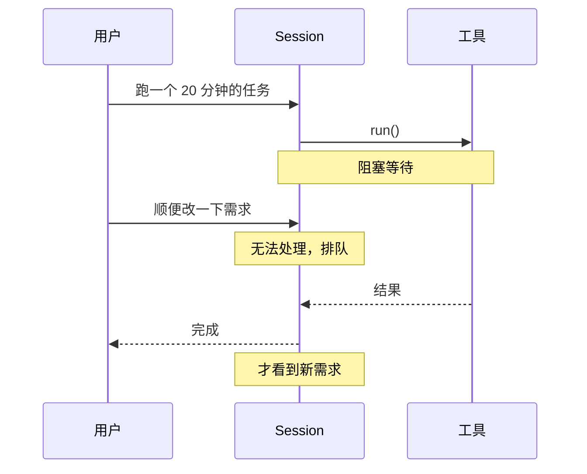
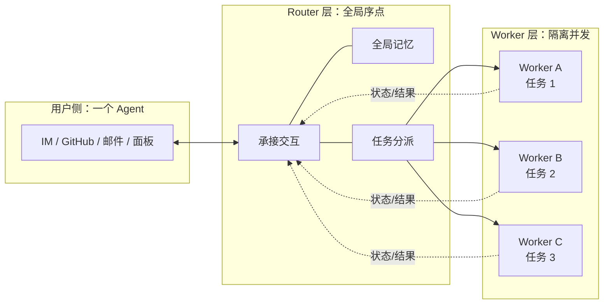

# 为什么需要 Super-agent

## 1.1 单任务 Agent 已经“够用”，瓶颈开始转移

过去一年，以 Coding Agent 为代表的单任务 Agent 证明了一件事件：
模型能够使用工具解决复杂问题，且越来越少需要人持续监控、逐步干预。
人的角色从“写每一行代码/每一条命令”，上移到“决定做什么、验收结果”。

这一步变化带来一个反直觉的后果：

> **单任务越自动，多任务越依赖人。**

因为当一个任务不再需要人盯着时，人自然会同时开更多任务。但现有 Agent 以**单一 Session**
为基本单位，不同 Session 彼此独立。人要并行推进多项工作，就得手动切换、自己记住每个
Session 的上下文。DeepSeek 团队观察到的经验上限是：

$$
K_{\text{active}} \approx 3 \sim 5
$$

即一个人通常只能同时跟进 3 到 5 个活跃 Session。这不是模型的限制，而是人的工作记忆与
上下文切换成本的限制。于是出现一个结构性矛盾：

- **单任务上限**取决于模型能力；
- **多任务上限**取决于人的注意力。

模型继续变强，只抬高前者；后者不变，整体生产力仍然被卡住。

## 1.2 Session 作为基本单位的三重代价

把 Session 同时当作“技术上的上下文容器”和“面向用户的项目管理单位”，会带来三个问题。

### 代价一：同步阻塞

经典 ReAct Loop 中，模型发起一次同步的 `run()` 工具调用后，循环会阻塞，直到工具执行完毕
并返回结果。在此期间，会话无法响应任何新的用户输入。

这意味着一个长任务会“占住”整个会话：

### 代价二：多任务上下文混乱

如果为了并发而给每条事件新开 Session，虽然吞吐上去了，但任务之间一旦不完全独立，
就缺少全局上下文：方案 A 在 IM 里定了，方案 B 在 GitHub 评论里改了，两个 Session 互相不知道。
多个 Session 各自向用户回复，也会造成交互混乱。

### 代价三：设备离线即停

现有本地 Agent 默认把三样东西绑在同一台设备上：

- 推进 Agent Loop 的**计算**；
- 需要持久保存的**会话状态**；
- 代码仓库、本地工具链等**执行环境**。

设备休眠、断网、进程崩溃，Agent 就停止运行；换一台设备，上下文和执行环境都带不过去。

## 1.3 两种朴素扩展为什么不够

面对多任务，最直接的两种做法都不足以解决问题。

### 做法 A：一个 Session + Subagent 工具

把所有事件都塞进主 Session，需要时调用 Subagent 分担子任务。

- 优点：上下文最连续，全局信息都在。
- 缺点：主 Session 仍是串行的单 ReAct Loop；任务一多就排队；主 Session 被新消息不断打断；
  Subagent 是否被调用、怎么拆分，取决于模型临场判断和提示词，行为不稳定。

原文实验里，中性提示下模型 5 次运行一次都没调用 Subagent，所有工作都在主 Session 里做，
p95 完成时间达到 29.5 分钟。改成“优先委派”提示后，5 次有 4 次委派，仍然慢于 Super-agent，
剩下 1 次模型判断工作“很小”而自己执行，形成长尾。

这说明：**把并发寄托在提示词和模型临场判断上，是不可靠的。**

### 做法 B：每条事件新开一个 Session

- 优点：并发吞吐最高，任务之间互不阻塞。
- 缺点：缺少全局上下文；跨任务决策无法汇总；多个 Session 各自回复，用户面对的是“一群 Agent”，
  而不是“一个 Agent”；Session 数量再次变成人的认知负担。

### 做法 C：Super-agent 的双层拆分

把“维护全局连续性”与“高并发执行”拆到两层：

- **Router 层**：常驻，承接人类交互、维护全局上下文、做任务间分派；
- **Worker 层**：上下文隔离，并发执行具体任务。

用户侧看到的是一个 Agent；系统内部才有多个 Session。**Session 成为实现细节，而不是用户的认知负担。**

这个拆分是后文所有设计的起点。它不是一个新模型，而是一个**系统层选择**。

## 1.4 四个特征，本质是四个系统约束

把四个特征翻译成系统语言，会更容易看清它们各自要求什么。

| 特征 | 系统约束 | 主要代价 |
|---|---|---|
| 连续 | 跨信道、跨任务共享一份可检索的全局上下文 | 全局节点可能成为瓶颈；长程记忆难 |
| 高效 | 多个任务并行执行，互不阻塞 | 并发调度、资源隔离、冲突处理 |
| 主动 | 系统由环境事件驱动，而不是只由人输入驱动 | 噪音过滤、误触发、授权边界 |
| 持久 | 计算、状态、环境解耦；异常可恢复 | 分布式复杂性、安全暴露面 |

这四个约束并不独立：

- 连续与高效存在直接权衡：越共享上下文，越难并行；越并行，越容易割裂。
- 主动会放大持久与安全问题：Agent 能自己找活干，也就意味着它能自己犯错。
- 持久会放大连续问题：运行越久，上下文越多，越需要选择性记忆。

因此，Super-agent 的架构不是“四个功能拼起来”，而是**在四组约束之间找一组可工程化的折中**。

## 1.5 一个粗略的量化模型

下面三个模型不是原文的公式，而是帮助理解设计取舍的简化工具。

### 模型一：人的注意力上限

设单个任务的平均处理时长为 $T$，每次上下文切换的固定成本为 $c$，人同时维护 $K$ 个活跃任务。
人的有效吞吐大致满足：

$$
\text{Throughput}_{\text{human}} \le \frac{K}{T + c}
$$

当 $T$ 很大（长任务）时，$K$ 个小任务也会被人频繁切换拖慢。系统的目标不是提高 $K$，
而是**把人从 $K$ 个 Session 的维护中移出去**，只保留“决策/验收”这两个高价值动作。

### 模型二：Little's Law 与所需并发

对任务系统，Little's Law 给出：

$$
L = \lambda W
$$

其中 $L$ 是系统中的平均任务数，$\lambda$ 是到达率，$W$ 是平均逗留时间。
若希望 $W$ 不随 $\lambda$ 增长而爆炸，系统必须提供足够的并发 $C$：

$$
C \ge \lambda W
$$

人只能提供 $K \approx 3 \sim 5$ 的“并发”，而环境事件的到达率 $\lambda$ 可能远高于此。
Super-agent 的 Worker 层，本质上是在系统侧补足这个并发缺口。

### 模型三：Token 换时间

原文没有给出“单 Session vs Super-agent”的 token 比值，只说明 Super-agent 因维护多个独立会话，
读缓存 token 高于单 Session。它给出的具体数字是 Super-agent 内部的直通消融：

$$
C_{\text{direct}} = 23.23\text{M},\qquad C_{\text{no-direct}} = 31.77\text{M}
$$

$$
\frac{C_{\text{no-direct}}}{C_{\text{direct}}} \approx 1.37
$$

即**去掉订阅直通会增加约 37% 的读缓存 token**；反过来说，直通版本比无直通版本少约 27%
（$23.23/31.77 \approx 0.731$）。

这个数字只说明直通机制的价值，**不是** Super-agent 相对单 Session 的开销。
Super-agent 的整体 token 成本高于单 Session，但原文没有给出具体比值。

> 注意：这里的 token 是“读缓存 token”，不是总账单；原文也没有给出美元成本。
> 37% 只能说明直通前后的相对开销，不能直接换算成价格，也不能当作 Super-agent 的总开销。

## 1.6 一个关键判断：Session 应该是实现细节

原文有一句很关键的话：

> 让用户手动管理 Session，在很大程度上是从底层 LLM API 延续下来的设计惯性；
> Session 应当是系统的实现细节，而不应是用户的认知负担。

这句话的背景是：Session 同时承担了两件事：

1. **技术上的上下文管理**：哪些消息进入模型窗口、如何截断、如何召回；
2. **面向用户的项目管理**：用户在哪个窗口里跟进哪件事。

把两者解耦后，产品可以自由决定“用户看到什么”，而不必让底层 Session 数量暴露给用户。
这也是后文“一个聊天页背后可以是多个 Worker”的前提。

## 1.7 Super-agent 不是什么

| 常见误解 | 实际情况 |
|---|---|
| 是一个新模型 | 不是。它是 Agent 形态与系统架构；模型只是其中一个组件 |
| 就是多 Agent | 不是。多 Agent 通常指单任务内的角色协作；Super-agent 的重点是任务间调度与连续性 |
| 就是多开几个聊天窗口 | 不是。用户侧仍是一个 Agent；多会话被系统隐藏 |
| 就是更长的上下文窗口 | 不是。长上下文不解决并发、持久化、主动性和授权 |
| 是 DeepSeek 的正式产品 | 不是。官方明确说原型仅用于验证技术路线 |
| 一定比单 Agent 好 | 不一定。它用更多 token 与复杂度换时间/稳定性，有明确适用边界 |

## 1.8 小结与思考题

**小结**：Super-agent 的出现，不是因为模型不会干活，而是因为模型越会干活，人越容易被
“管理多个会话”这件事卡住。它把 Session 从产品界面降级为系统实现，把人的角色上移到决策与验收。

**思考题**：

1. 如果你的场景里 $\lambda$ 很低（一天只有几个任务），Super-agent 的哪部分仍然有价值？
2. 如果任务之间高度耦合、必须共享同一份上下文，双层架构的收益会如何变化？
3. “人的注意力上限 3-5 个 Session”是原文的观察，不是定律。什么因素会让它变大或变小？
4. 直通机制省下的约 27% Router token，在什么规模/负载下最有价值？请给出一个粗略的盈亏平衡式。

下一章把四个特征映射到五个模块，给出整体架构图与一次任务的完整生命周期。
