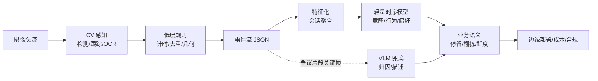

# 视频 + AI(零售/生鲜视觉智能)学习路线

> 目标：系统掌握"摄像头 → CV 感知 → 理解/决策 → 事件流 → VLM 语义"的完整链路，
> 能设计/评估零售（尤其生鲜）场景的视频 AI 方案，能与算法团队有效对话。
> 定位：方案/架构导向，实践驱动（70% 实践 + 30% 理论），非算法工程师训练路径。

## 学习方式（沿用本目录惯例）

- 通过提问向 Teacher 学习，问答沉淀到 `qa/`（编号 `NNN-主题.md`）
- 追问追加到原 qa 文件，不覆盖
- 每个核心概念从**数学角度**理解输入、输出、计算过程（LaTeX 公式 + mermaid 图表）
- 每阶段末更新本 README 或生成 mdbook 小结

## 体系地图（学完应能画出）



## 贯穿案例：零售客户动线识别（学习锚点）

> 整个学习路径以这个案例为目标——每阶段的知识都服务于它，最终 P6 就是它的端到端实现。

**案例描述**：顾客进店后，系统识别其在**各货架前的停留时间、观察/触摸过的商品及时间**，聚合为"看买行为"分析（偏好推断、看买转化、陈列优化）。

**完整链路与阶段映射**：

| 链路环节 | 技术 | 对应阶段 |
|---|---|---|
| 人检测 + 跨摄像头跟踪(ReID) | YOLO + ByteTrack/ReID | 阶段 2 |
| 像素 → 货架/层格映射 | 标定表（配置，非模型） | 阶段 5（理解层） |
| 停留判定（ROI + 计时 + 阈值） | 规则/状态机 | 阶段 5 |
| 触摸/观察识别（手-层格重叠） | 手部检测 + 规则；争议调 VLM | 阶段 3 + 4 |
| 会话聚合 + 特征化 | 事件流 → 数值特征向量 | 阶段 5 |
| 意图/偏好推断（犹豫/翻拣/挑选） | 轻量时序模型（事件特征 → 标签） | 阶段 5 |
| 看买转化（× POS 明细） | 数据关联（非视觉） | 阶段 6 |
| 争议片段语义化 | VLM 关键帧（3-10 帧） | 阶段 4 |
| 匿名化/合规 | 匿名 ID、不采人脸、保留期 | 阶段 6 |

**粒度取舍（贯穿全程的判断基准）**：
```
货架级停留:视觉直出(成熟、便宜)
层格级触摸:手部检测+规则(试点)
SKU 级观察:靠收银回推(不做纯视觉)
```

## 阶段路线（6 阶段，约 3-4 个月，每周 5-8 小时）

### 阶段 0：前置基础（1 周）
- Python + NumPy、线性代数/概率概念、图像表示（像素/颜色空间/帧）
- **数学要点**：矩阵乘法与图像变换、概率分布

### 阶段 1：CV 与图像基础（2 周）
- 传统 CV（滤波/边缘）了解即可；**CNN 原理为重点**（卷积/池化/感受野/预训练）
- **数学要点**：离散卷积定义、卷积输出尺寸公式、参数量与感受野计算
- 实践 P1：图像分类 demo（迁移学习）

### 阶段 2：检测 / 分割 / 跟踪（4 周）—— 核心
- YOLO 检测（anchor/NMS/损失）、分割概念、ByteTrack/DeepSORT/ReID
- **数学要点**：IoU、NMS 算法、检测损失（分类+回归）、mAP 计算、卡尔曼滤波（贝叶斯递推）、匈牙利匹配、对比损失
- 实践 P2：YOLO 检测 + 跟踪，实现区域人数统计

### 阶段 3：OCR / 姿态 / 行为（2 周）
- PP-OCR 两段式管线、姿态关键点、行为识别（时序模型概念层）
- **数学要点**：CTC 损失、序列到序列、时序建模（3D 卷积/注意力）
- 实践 P3：OCR 识别价签/商品标签

### 阶段 4：多模态 VLM 与视频理解（3 周）
- VLM 架构（视觉编码器+投影+LLM）、CLIP 对比学习、视频理解（抽帧/流式/长视频）
- **数学要点**：图像→token 的映射、token 拼接与注意力（呼应 attention-is-all-you-need）、对比损失、量化成本模型
- 实践 P4：Qwen-VL/Qwen3.8-27B 图片问答（生鲜鲜度）+ 视频抽帧理解

### 阶段 5：工程化与部署（3 周）
- 边缘部署（ONNX/INT8 量化/TensorRT/NPU 盒子）、事件流设计、边缘-云端分层、规则/状态机/特征化、数据飞轮
- **数学要点**：量化误差分析（PTQ/QAT）、统计阈值、特征归一化
- 实践 P5：本地/边缘跑 YOLO + 事件流输出（JSON）

### 阶段 6：零售场景与系统设计（1 周）
- 客流/货架/防损/鲜度行业方案、隐私合规、生鲜损耗方法论
- 终极项目 P6：**动线识别端到端 demo**——摄像头 → 检测跟踪 → 事件流 → 特征化 → 轻量模型 → VLM 兜底，产出"顾客货架停留/触摸序列 + 偏好报告"（即贯穿案例的简化落地）

## 预置问答清单（可直接提问，逐条沉淀到 qa/）

**阶段 1**
- 001：图像在计算机中如何表示？CNN 的卷积在数学上是什么？
- 002：感受野怎么算？预训练模型为什么能迁移？
- 003：视频识别时，检测结果如何与空间位置（地面/货架/层格）关联？

**阶段 2**
- 004：YOLO 的 anchor、NMS、损失函数分别解决什么？
- 005：目标跟踪为什么"免训练"？卡尔曼滤波和匈牙利匹配的数学原理？
- 006：ReID 的度量学习（对比损失）如何工作？

**阶段 3**
- 007：OCR 为什么是"检测+识别"两段式？CTC 损失解决什么问题？
- 008：行为识别为什么难？时序建模和单帧检测的本质区别？

**阶段 4**
- 009：VLM 如何把图像变成 token？视觉编码器和 LLM 如何对接？
- 010：视频理解 = 抽帧？成本模型怎么算（帧数 × token）？
- 011：CLIP 的对比学习目标是什么？

**阶段 5**
- 012：INT8 量化为什么会损失精度？PTQ 和 QAT 区别？
- 013：事件流怎么设计？边缘 CV 与云端 VLM 如何分工？
- 014：规则和轻量模型怎么分工？什么情况该上模型？

**阶段 6（动线案例专项）**
- 015：生鲜鲜度识别为什么 VLM 能做、传统 CV 不能？
- 016：视频 AI 的隐私合规边界（人脸/轨迹）？
- 017：动线案例的"货架级→层格级→SKU 级"粒度取舍，成本差多少？
- 018：停留/触摸的"事件流 → 特征化 → 轻量模型"为什么要这么做，纯规则哪里崩？
- 019：看买转化（轨迹 × POS）关联有哪些坑（时间对齐、匿名 ID 匹配）？

## 学习策略

1. 每个概念问三件事：**输入是什么、输出是什么、中间计算是什么**（数学角度）
2. 每个阶段一个可演示产出，全部贴零售/生鲜场景
3. 别掉进论文/数学黑洞——目标是判断力和对话能力
4. 学完每阶段,把 qa 沉淀更新为本 README 的小结或 mdbook

## 相关主题

- [attention-is-all-you-need](../attention-is-all-you-need)：VLM 注意力机制基础
- [lora](../lora)：VLM 微调基础（阶段 4 关联）
