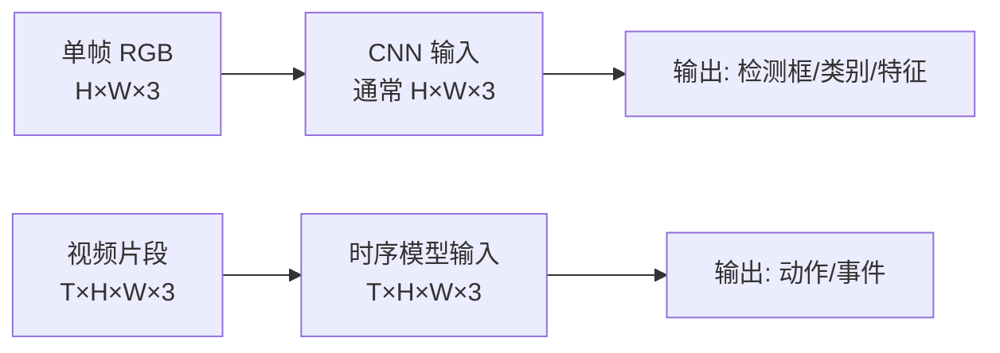

# 001：CV 与图像基础 —— 图像表示与卷积的数学

> 阶段 1 第一课 | 目标：从数学角度理解"图像在计算机里是什么"、"卷积在算什么"

---

## 1. 图像在计算机中如何表示

### 1.1 灰度图：一个二维矩阵

一张灰度图就是一个矩阵 $I \in \mathbb{R}^{H \times W}$，每个元素是一个像素的亮度：

$$
I = \begin{bmatrix}
  0 & 100 & 200 & 50 \\
  255 & 30 & 80 & 120 \\
  10 & 90 & 180 & 60
\end{bmatrix}, \quad H=3,\; W=4
$$

- 数值范围：$0$（黑）到 $255$（白），8 bit 量化
- 常用归一化：$I_{norm} = I / 255 \in [0, 1]$ 或 $I / 127.5 - 1 \in [-1, 1]$（利于梯度）

### 1.2 彩色图：一个三维张量

$$
I \in \mathbb{R}^{H \times W \times C}, \quad C = 3 \text{（RGB 三通道）}
$$

每个像素由三个通道值组成：$I(i, j) = (R, G, B)$。**通道是独立的二维矩阵**——卷积分别在每个通道上做，然后求和（见 §2.3）。

### 1.3 视频：四维张量（本课程主题）

$$
I \in \mathbb{R}^{T \times H \times W \times C}
$$

$T$ 是帧数。**视频 = 按时间排列的图像序列**——这就是为什么"视频 CV" = "图像 CV + 时间维度"。

### 1.4 关键概念：张量的"形状"就是模型的输入契约



---

## 2. 卷积的数学定义

### 2.1 二维离散卷积（互相关）

深度学习里的"卷积"实际是**互相关**（核不翻转）。定义：

$$
(I * K)(i, j) = \sum_{m=0}^{M-1} \sum_{n=0}^{N-1} I(i+m,\; j+n) \cdot K(m, n)
$$

其中核 $K \in \mathbb{R}^{M \times N}$ 在图像上滑动，每个位置做一次**逐元素相乘再求和**（内积）。

### 2.2 手算一个 3×3 例子

图像 $I$（左上 3×3 块）与核 $K$：

$$
I = \begin{bmatrix} 1 & 2 & 3 \\ 4 & 5 & 6 \\ 7 & 8 & 9 \end{bmatrix}, \quad
K = \begin{bmatrix} 1 & 0 \\ 0 & -1 \end{bmatrix}
$$

输出 $O(0,0)$ 的计算：

$$
O(0,0) = 1 \times 1 + 2 \times 0 + 4 \times 0 + 5 \times (-1) = 1 - 5 = -4
$$

**直觉**：核关注的是"左上减右下"——即检测对角方向的灰度差。

### 2.3 多通道卷积：通道间求和

输入 $C_{in}$ 个通道，每个通道一个核 $K_c$：

$$
O(i,j) = \sum_{c=1}^{C_{in}} \sum_{m} \sum_{n} I_c(i+m, j+n) \cdot K_c(m, n) + b
$$

- **一个输出通道** = $C_{in}$ 个核（每个输入通道一个）求和 + bias
- 输出 $C_{out}$ 个通道 = $C_{out}$ 组这样的核

### 2.4 为什么卷积能检测边缘

Sobel 垂直边缘核：

$$
G_x = \begin{bmatrix} -1 & 0 & 1 \\ -2 & 0 & 2 \\ -1 & 0 & 1 \end{bmatrix}
$$

它近似水平方向的梯度（差分）：

$$
G_x \approx \frac{\partial I}{\partial x}
$$

平坦区域输出 ≈ 0，边缘处输出大（大正/大负）——**卷积 = 局部模式匹配**。

---

## 3. CNN 卷积 vs 传统卷积

| 对比 | 传统卷积（Sobel/高斯） | CNN 卷积 |
|---|---|---|
| 核的来源 | **人工设计** | **学习到的参数**（训练更新） |
| 核的数量 | 固定几个 | $C_{out}$ 组，每层几百上千 |
| 适配性 | 通用（边缘/模糊） | 针对任务学（检测人/货架/手） |
| 训练 | 无 | 反向传播更新核权重 |

**CNN 的卷积层本质**：$C_{out} \times C_{in} \times K \times K$ 个可学习参数，通过梯度下降学会"该看什么模式"。

---

## 4. 卷积输出尺寸公式（核心数学）

$$
O = \left\lfloor \frac{H - K + 2P}{S} \right\rfloor + 1
$$

- $H$：输入尺寸，$K$：核尺寸，$P$：padding，$S$：stride

**数值验证**：

| 输入 H | 核 K | Padding P | Stride S | 输出 O |
|---|---|---|---|---|
| 32 | 3 | 1 | 1 | $(32-3+2)/1 + 1 = 32$（尺寸不变） |
| 32 | 5 | 0 | 1 | $(32-5)/1 + 1 = 28$ |
| 32 | 3 | 0 | 2 | $(32-3)/2 + 1 = 15$（降采样） |

**参数量**（一层）：

$$
\text{params} = C_{in} \times C_{out} \times K \times K + C_{out} \quad (\text{bias})
$$

例：$C_{in}=3, C_{out}=64, K=3$ → $3 \times 64 \times 9 + 64 = 1792$ 参数——远小于全连接层。

---

## 5. 池化（Pooling）

对每个窗口取统计量，无参数：

$$
\text{MaxPool}(i,j) = \max_{m,n \in \text{窗口}} I(i+m, j+n)
$$

- 作用：降采样（$2\times2$ 池化尺寸减半）、提供小范围平移不变性
- 数学性质：只取最大值，**无学习参数、无梯度更新目标**

---

## 6. 感受野（Receptive Field）——预告

输出一个像素"看到"的输入区域大小，递推公式：

$$
RF_l = RF_{l-1} + (K_l - 1) \times \prod_{i=1}^{l-1} S_i
$$

- 例：两层 $3\times3$ 卷积（stride 1）→ 感受野 $5\times5$；三层 → $7\times7$
- **意义**：层数越深，输出像素越能"看"到更大的输入区域——这决定模型能否看到"整条货架"还是"一个商品"

（下一课 002 详细推导 + 预训练迁移原理）

---

## 7. 本课小结（输入 → 计算 → 输出）

```
输入:  图像张量  I ∈ R^{H×W×C}
计算:  卷积(逐窗口内积求和) → 激活 → 池化,层层堆叠
输出:  特征图(深层=语义特征,浅层=边缘/纹理)
```

**一句话**：图像是张量，卷积是"可学习的局部模板匹配"，CNN 通过堆叠卷积层从边缘→纹理→部件→对象逐层抽象。

---

## 关键概念清单

- [ ] 图像 = 张量（灰度 2D / 彩色 3D / 视频 4D），通道概念
- [ ] 二维离散卷积公式（互相关：不翻转核）
- [ ] 卷积 = 逐元素相乘求和 = 局部模式匹配
- [ ] 多通道卷积：通道间求和 + bias
- [ ] Sobel 核为什么能检测边缘（≈ 梯度）
- [ ] CNN 核是可学习参数（vs 传统设计核）
- [ ] 输出尺寸公式 $O = \lfloor(H-K+2P)/S\rfloor + 1$
- [ ] 一层卷积参数量 = $C_{in} \times C_{out} \times K^2 + C_{out}$
- [ ] 池化：无参数、降采样、平移不变
- [ ] 感受野概念（递推公式，下一课深挖）

## 下一步

- **002**：感受野递推 + 预训练模型为什么能迁移（迁移学习原理）
- 或直接 **实践 P1**：用 PyTorch 迁移学习跑通图像分类 demo（把概念落到代码）

想先继续理论（002）还是先上手实践（P1）？也可以带着问题来，我逐条展开。

---

## 追问 1：CNN 卷积学习的是核矩阵中的参数？

**是的**——卷积层学习的核心就是核矩阵（Kernel/Filter）的权重 + bias。

### 精确化：一层卷积学习什么

一个卷积层的可学习参数是**四维张量**（不是单个矩阵）：

$$
K \in \mathbb{R}^{C_{in} \times C_{out} \times K \times K}, \quad b \in \mathbb{R}^{C_{out}}
$$

- 每个**输出通道**对应一组 $C_{in}$ 个 $K \times K$ 核（分别匹配各输入通道）
- 总参数 = $C_{in} \times C_{out} \times K^2 + C_{out}$（回到 §4 的公式）

例：$3 \to 64$ 通道、$3\times3$ 核 → $3 \times 64 \times 9 + 64 = 1792$ 个可学习参数。

### 学习机制（前向 → 反向 → 更新）

```
前向:   O = I * K + b                     （卷积 + bias）
损失:   L = CrossEntropy(O, y)
反向:   ∂L/∂K = ∂L/∂O · ∂O/∂K             （卷积的梯度仍是卷积——转置卷积）
更新:   K ← K − η · ∂L/∂K                 （SGD/Adam）
```

**关键直觉**：核从随机初始化（或预训练权重）出发，被数据"塑造"——训练过程就是不断调整核的每个元素，直到它检测到对任务有用的局部模式。

### 与 Sobel 的对照（强化直觉）

| | Sobel（传统） | CNN 核（学习） |
|---|---|---|
| 来源 | 人工设计（检测边缘） | 训练从数据中学 |
| 初始 | 固定 | 随机 / 预训练 |
| 结果 | 就是边缘核 | 浅层 ≈ 边缘/纹理（长得像 Sobel），深层 = 部件/对象 |
| 更新 | 永不 | 每个 batch 更新一次 |

**一句话**：是的，核矩阵参数就是 CNN 卷积层"学的东西"；训练 = 用梯度调整核权重，让"局部模式匹配"对准任务；浅层学的模式通用（边缘），深层学的模式任务相关（这正是下一课"预训练迁移"的数学基础）。
