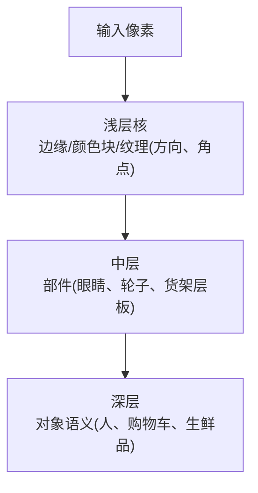

# 002：感受野与预训练迁移

> 阶段 1 第二课 | 目标：推导感受野递推，理解"预训练模型为什么能迁移"（迁移学习数学原理）

---

## 1. 感受野（Receptive Field）：输出像素"看到"多大输入区域

### 1.1 定义

**感受野** = 输出特征图上一个像素，在输入图像上对应的区域大小。

第一层卷积：输出像素由 $K_1 \times K_1$ 的输入窗口计算 → $RF_1 = K_1$。

### 1.2 递推公式（核心推导）

第 $l$ 层感受野：

$$
RF_l = RF_{l-1} + (K_l - 1) \times \prod_{i=1}^{l-1} S_i
$$

**推导直觉**：每加一层卷积，感受野向外扩展 $(K_l - 1)$ 个像素——但之前所有层的 **stride 乘积** 会把这个扩展"放大"（stride 相当于把上层输出"压缩"回输入坐标的缩放因子）。

### 1.3 数值验证

**3×3 卷积堆叠（stride 1）**：

| 层数 | 感受野 | 计算 |
|---|---|---|
| 1 | 3 | $3$ |
| 2 | 5 | $3 + 2\times1 = 5$ |
| 3 | **7** | $5 + 2\times1 = 7$ |
| $l$ | $2l+1$ | $3 + 2(l-1)$ |

**规律**：$n$ 层 $3\times3$（stride 1）→ 感受野 $(2n+1)\times(2n+1)$。**两层 3×3 等价于一层 5×5 的感受野，但参数更少**（$2\times9=18 < 25$）。

**带 stride 的扩展**（stride 2 层会把后续扩展加倍）：

$$
RF_l = RF_{l-1} + (K_l - 1) \times 2^{l-1} \quad (\text{全 stride 2})
$$

### 1.4 为什么重要（对检测场景）

```
浅层:感受野小 → 看到"一个商品"/"一只手"
深层:感受野大 → 看到"整个货架"/"人 + 上下文"
```

检测模型要同时满足两者 → **多尺度特征金字塔**（FPN）：不同层级的特征图各司其职（阶段 2 讲 YOLO 时展开）。

---

## 2. CNN 学到了什么：特征层次性

### 2.1 层次结构（从数据中观察到的规律）



**关键规律（迁移学习的根基）**：
- **浅层特征 = 图像域通用**：自然图像都有边缘、纹理、颜色渐变——猫、车、货架都一样
- **深层特征 = 任务相关**：什么是"货架"、什么是"苹果"——跟数据集绑定

### 2.2 数学视角

CNN 是特征提取器 $f_\theta: x \mapsto z$（像素 → 特征向量），加上分类头 $g_\phi: z \mapsto y$（特征 → 类别）：

$$
\hat{y} = g_\phi(f_\theta(x))
$$

- $\theta$（卷积核）：学到"怎么把图像变成有用特征"
- $\phi$（分类头）：学到"特征怎么映射到类别"

---

## 3. 预训练为什么能迁移

### 3.1 核心论点

**预训练学到的浅层特征表达（边缘/纹理/颜色）与目标任务共享**——在 ImageNet/COCO 上学到的"边缘检测器"，拿到零售场景一样有效（货架照片也有边缘）。**不需要重新学"什么是边缘"，只需要学"货架长什么样"**。

### 3.2 两种迁移方式（数学上都是初始化策略）

| 方式 | 训练什么 | 数学 | 适用 |
|---|---|---|---|
| **冻结特征提取**（Feature Extraction） | 只训分类头 $\phi$ | $f_\theta$ 固定，$\theta$ 不更新；只优化 $\phi$ | 小数据、目标域接近预训练域 |
| **微调**（Fine-tuning） | $\theta$ + $\phi$ 都训 | 全部参数更新，但 $\theta$ 用**低学习率** | 数据足、目标域差异大 |

**为什么微调时浅层学习率要低**：浅层特征已经很通用，大步更新会破坏预训练学到的通用表达（灾难性遗忘）；深层和分类头离任务近，需要大步学。

### 3.3 数据效率（迁移的最大收益）

从零训练需要海量数据（模型没有先验，所有特征都要从数据学）；预训练相当于给了"特征先验"——目标任务只需学"差异部分"。数学上：预训练提供了更好的初始化 $\theta_0$，使损失面收敛更快、更稳（落入更优局部极小）。

---

## 4. 与零售场景的联系（为什么"预训练 + 微调"是工业界主流）

```
COCO 预训练(人/车/通用物体) ──微调──> 零售检测模型(人/货架/手/购物车)

可复用的: 边缘/纹理/颜色/形状等浅层特征(COCO 有)
要重学的: "什么是货架空位""什么是生鲜堆头"等语义(COCO 没有)
```

| 目标 | COCO 预训练够吗 | 需要行业微调吗 |
|---|---|---|
| 检测"人"（客流） | ✅ 够（COCO 大量人） | 少量即可 |
| 检测"手"（触摸识别） | ⚠️ COCO 有手部但少 | 需要补 |
| 检测"货架/生鲜/空位" | ❌ COCO 没有 | **必须自采数据微调** |

这正是阶段 2 讲 YOLO 时的落地路径：**预训练权重起步 → 自采几百~几千张零售图微调 → 识别货架/人/手**。

---

## 5. 本课小结

```
感受野: RF_l = RF_{l-1} + (K_l-1)·∏S_i —— 层越深看到越大,stride 放大扩展
特征层次: 浅层通用(边缘/纹理) → 深层任务相关(对象)
迁移: 预训练提供特征先验 θ₀,只学"差异部分" → 数据效率高
```

---

## 关键概念清单

- [ ] 感受野定义：输出像素对应的输入区域
- [ ] 递推公式 $RF_l = RF_{l-1} + (K_l-1)\prod S_i$ 及推导直觉
- [ ] 两层 3×3 = 一层 5×5 感受野，但参数更少（18 < 25）
- [ ] stride 放大感受野扩展（$\prod S_i$ 因子）
- [ ] 特征层次性：浅层通用 / 深层任务相关（迁移的根基）
- [ ] CNN = 特征提取器 $f_\theta$ + 分类头 $g_\phi$
- [ ] 冻结 vs 微调：训练对象、学习率策略、适用场景
- [ ] 迁移 = 更好的初始化 $\theta_0$ → 收敛更快更稳
- [ ] 为什么货架/生鲜识别必须自采数据微调（COCO 无此类语义）

## 下一步

- **003**：图像识别与空间位置关联——像素 → 世界坐标 → 语义区（阶段 1→2 的桥接，本课的直接延伸）
- **004**（阶段 2 第一课）：YOLO 目标检测原理——anchor、NMS、损失函数（本课程的核心能力）
- 或先 **P1 实践**：迁移学习图像分类 demo（把"冻结 vs 微调"落到代码，直观感受预训练威力）

建议：先花 30 分钟跑 P1（冻结 vs 微调对比），再进 003/004，理论与实践咬合更好。
