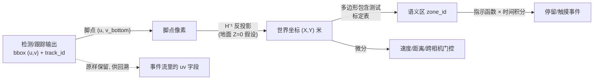

# 003：图像识别与空间位置的关联 —— 像素 → 世界 → 语义区

> 阶段 1→2 桥接课 | 目标：把检测框的像素坐标 $(u,v)$ 变成**可计算、可累积**的空间量：地面坐标 $(X,Y)$ 与语义区 `zone_id`，并给出每一步的数学与误差预算。
> 这是 README 里"像素 → 货架/层格映射（标定表）"那一行的原理展开。

---

## 0. 先分清三种"位置"

| 位置 | 形式 | 用途 | 谁消费 |
|---|---|---|---|
| **图像位置** | 像素 $(u,v)$、bbox、mask | 裁剪取图、人工复核截图 | 前端、VLM 兜底 |
| **物理位置** | 世界坐标 $(X,Y,Z)$，单位米 | 距离/速度/跨相机拼接/floorplan | 中间层（可离线重算） |
| **语义位置** | `zone_id`、货架号、层格号 | 停留、触摸、越界等业务事件 | 业务报表、特征化 |



**核心论点**：业务只消费"语义位置 + 时间"；世界坐标是中间桥梁（标定表改了能离线重算）；像素位置只做回溯和取图。三者混用是这类系统最常见的 bug 源——§4、§5 用具体数字说明混用的代价。

---

## 1. 数学骨架：针孔模型

$$
s\begin{bmatrix} u \\ v \\ 1 \end{bmatrix}
= K\,[R\,|\,t]\begin{bmatrix} X \\ Y \\ Z \\ 1 \end{bmatrix}
= P\begin{bmatrix} X \\ Y \\ Z \\ 1 \end{bmatrix}
$$

- $K$（内参）：$f_x, f_y, c_x, c_y$ + 畸变系数 $(k_1,k_2,p_1,p_2)$
- $[R|t]$（外参）：相机位姿，世界 → 相机
- $P = K[R|t]$：$3\times4$ 投影矩阵，11 个自由度

**反投影是一条射线，不是一个点**：

$$
\mathbf{d} = R^{\top}K^{-1}\begin{bmatrix} u \\ v \\ 1 \end{bmatrix}
$$

世界点是 $\mathbf{C} + \lambda\mathbf{d}$，$\lambda$ 未知。**单目相机只给方向、不给距离**——所以"关联空间位置"的本质是：**人为补一个约束**，把 $\lambda$ 定下来。

三种约束，对应三种工程方案：

| 约束 | 方案 | 场景 |
|---|---|---|
| 目标站在**地面**上（$Z=0$） | 平面单应性 $H$ | 人、购物车、动线（主力） |
| 目标在**货架立面**上 | 竖直平面单应性 $H_{shelf}$ | 手、触摸层格 |
| 有**额外测距** | 双目/深度/RGBD/多相机三角化 | 高精度要求 |

---

## 2. 地面平面 → 单应性（零售的主力解法）

令 $Z=0$，$P$ 的第三列乘 0 消失，剩 $3\times3$：

$$
\begin{bmatrix} X \\ Y \\ 1 \end{bmatrix} \sim H\begin{bmatrix} u \\ v \\ 1 \end{bmatrix},
\qquad
H = K\begin{bmatrix} r_1 & r_2 & t \end{bmatrix}
$$

$H$ 差一个尺度，$8$ 个自由度 → **4 组对应点**即可解（DLT）。每组 $(X,Y)\leftrightarrow(u,v)$ 给两行：

$$
\begin{bmatrix}
-X & -Y & -1 & 0 & 0 & 0 & uX & uY & u \\
 0 & 0 & 0 & -X & -Y & -1 & vX & vY & v
\end{bmatrix}\mathbf{h} = 0,
\quad \mathbf{h}=(h_{11},\dots,h_{33})^{\top}
$$

4 点拼成 $8\times8$；工程上用 **6~8 个点 + SVD 取最小奇异向量**（超定、抗噪，代价是几个毫秒，一次性）。

**数值验证**（合成相机：$1280\times720$，$f=800$px，机高 2.6m，俯角 35°，取 4m×6m 地面四角）：

| 世界点 $(X,Y)$ | 投影像素 $(u,v)$ |
|---|---|
| $(-2,\,1.5)$ | $(51.8,\ 733.4)$ |
| $(2,\,1.5)$ | $(1228.2,\ 733.4)$ |
| $(2,\,7.5)$ | $(849.6,\ 132.4)$ |
| $(-2,\,7.5)$ | $(430.4,\ 132.4)$ |

拟合得

$$
H=\begin{bmatrix}
0.01586 & 0 & -10.148 \\
0 & -0.0091 & 13.666 \\
0 & 0.005 & 1
\end{bmatrix}
$$

反投影四角，残差 $4.4\times10^{-15}$（精确解成立）。

> $H$ 的绝对值没意义（只差一个尺度），$h_{13}$ 这么大是因为世界原点离像面很远；换个原点数值就变。**只有映射结果可比。**

**畸变必须先矫正**。径向畸变让同名点系统性偏离，而 $H$ 只能表达平面透视，**吸收不了弯曲**：

$$
x_d = x_n(1+k_1 r_n^2 + k_2 r_n^4),\qquad r_n=\sqrt{x_n^2+y_n^2}
$$

$f=500$px、归一化半径 $r_n=1.4$（广角画面角点）、$k_1=-0.15$ 时，径向位移 $\approx 0.15\times1.4^3\times500\approx 206$px。换算到地面就是米级偏差——**拟合误差会假装很小（$H$ 强行摊平），业务误差却很大**。零售的 2.8~4mm 广角镜头是重灾区：先 `undistort`，再拟合 $H$。

---

## 3. 用哪个点关联：脚点，不是框中心

站立的人，bbox 底边中点 ≈ 脚底接触点，**只有这个点在地面 $Z=0$ 上**。

数值（1.7m 的人站在 $Y=3.0$m 处）：

| 取点方式 | 反投影结果 | 偏差 |
|---|---|---|
| bbox 底边中点（脚点） | $(0.00,\ 3.00)$ | 0 |
| bbox 中心 $(u,\,(v_{top}+v_{bot})/2)$ | $(0.00,\ 4.78)$ | **+178cm** |

更糟的是**偏差随身高漂移**，无法用常数补偿：

| 身高 | 框中心反投影的 $Y$ | 偏差 |
|---|---|---|
| 1.5m | 4.44 | 144cm |
| 1.7m | 4.78 | 178cm |
| 1.9m | 5.21 | 221cm |

**结论**：用脚点。遮挡/坐下/推车导致脚点不可见时，退化策略是——在 bbox 底边若干候选点里，选**与轨迹预测位置最一致**的那个（几何自洽），而不是随手取中心。

---

## 4. 误差预算：1px 到底是多少 cm

同一套标定，1 像素的像素误差在地面上放大多少（$f=800$px，机高 2.6m，俯角 35°）：

| 距离 $Y$ | 横向 1px | 深度 1px | 深度 3px（典型检测抖动） |
|---|---|---|---|
| 2m | 0.39cm | 0.47cm | 1.41cm |
| 4m | 0.60cm | 1.09cm | 3.26cm |
| 6m | 0.80cm | 1.97cm | 5.87cm |
| 8m | 1.01cm | 3.10cm | **9.25cm** |
| 10m | 1.21cm | 4.49cm | 13.37cm |
| 12m | 1.42cm | 6.13cm | 18.24cm |
| 14m | 1.62cm | 8.03cm | 23.86cm |

规律（无俯仰时精确，有俯仰时沿视线近似）：

$$
\underbrace{\Delta d \approx \frac{d^2}{f\,h}\Delta v}_{\text{深度误差 }\propto d^2},
\qquad
\underbrace{\Delta x \approx \frac{d}{f}\Delta u}_{\text{横向误差 }\propto d}
$$

**工程含义（直接决定方案选型）**：

- 近处 1px ≈ 5mm，远处 1px ≈ 8cm → **全局统一的距离/区域阈值一定错**，阈值必须随 $d$ 缩放
- "层格级"要求约 10cm 精度：3px 抖动下需要 $d\lesssim 8$m。更远只有三条路——提高分辨率/换长焦、改成多相机、或**退回货架级粒度**（README 的粒度取舍表就是这个结论）
- 深度方向误差永远比横向大，且增长快（$d^2$ vs $d$）

---

## 5. 用错平面 = 系统性错位（触摸场景）

货架立面是**另一个平面**。手在 $Z\approx1.2$m，用地面 $H$ 反投影，等于假设手在地上：

| 手的真实位置 | 用地面 $H$ 得到 | 误差 |
|---|---|---|
| $(0.60,\ 2.00,\ 0.6)$ | $(0.78,\ 2.60)$ | 63cm |
| $(0.60,\ 2.00,\ 1.2)$ | $(1.11,\ 3.71)$ | **179cm** |
| $(0.60,\ 2.00,\ 1.8)$ | $(1.95,\ 6.50)$ | 470cm |

误差随高度急剧增大——**触摸识别全军覆没**。正确做法：给每个货架立面单独标一组点，拟合 $H_{shelf}$（竖直平面，坐标 $(x,z)$），手部关键点用它反投影；或者更一般地，做**射线与平面求交**：

$$
\mathbf{C}+\lambda\mathbf{d} \in \Pi,\qquad \Pi:\ \mathbf{n}^{\top}\mathbf{P}=c
\;\Longrightarrow\;
\lambda=\frac{c-\mathbf{n}^{\top}\mathbf{C}}{\mathbf{n}^{\top}\mathbf{d}}
$$

用 $H_{shelf}$ 验证同一只手：$(x,z)=(0.20,1.35)$ 反投影回 $(0.20,1.35)$，残差 $\sim10^{-15}$。

**一条铁律**：一个 $H$ 只服务**一个平面**。标定表要按"被建模的平面"组织：地面一组、每个货架立面一组。用错平面不是噪声，是**系统偏差**，任何滤波都救不回来。

---

## 6. 时序关联：让位置有身份、有稳定性

### 6.1 身份先于位置

跟踪 ID 提供跨帧同一性：位置序列挂在 `track_id` 上，而不是帧上。没有 ID 时，"第 100 帧的框"和"第 101 帧的框"毫无关联，$H$ 反投影只是一堆散点。

### 6.2 滤波发生在世界坐标，不是像素坐标

卡尔曼状态转移（匀速模型）：

$$
\mathbf{x}_k=F\mathbf{x}_{k-1}+\mathbf{w}_k,\qquad
\mathbf{z}_k=H_k\mathbf{x}_k+\mathbf{v}_k,\qquad
\mathbf{x}=(X,Y,\dot X,\dot Y)
$$

关键在 $H_k$：它是 §4 那张表的**雅可比**，随 $d$ 变化——

$$
\sigma_{\text{world}} \approx \left|\frac{\partial (X,Y)}{\partial (u,v)}\right|\sigma_{\text{px}}
$$

于是"远处测量噪声大"被自动编码进 $H_k$，滤波器自然给远处观测**降权**。这就是"必须在世界坐标滤波"的真正收益：像素域的噪声是**异方差**的（近小远大），而标准卡尔曼假设固定的 $\mathbf{R}$——在像素域做，等于逼着一个均匀噪声模型去解释非均匀噪声，近处过滤波、远处欠滤波。

### 6.3 区域判定要滞回，不要单帧布尔

抖动 3px 就会让边界上的目标来回穿越。工程做法：进入需连续 $k$ 帧在内，离开需连续 $m$ 帧在外（$m>k$），再加最小驻留时长。

### 6.4 停留的数学定义：指示函数的时间积分

$$
D_{z}=\int_{t_0}^{t_1}\mathbf{1}\big[(X(t),Y(t))\in\Omega_z\big]\,dt
\;\approx\;\sum_{k}\Delta t_k\,\mathbf{1}\big[(X_k,Y_k)\in\Omega_z\big]
$$

这是整套设计能"一套轨迹算多种业务量"的原因：

- 停留 = 对时间积分（上式）
- 速度 = 对时间微分
- 路径长度 = $\sum\|\mathbf{p}_{k}-\mathbf{p}_{k-1}\|$
- 跨相机连续性 = 世界坐标距离的门控

**位置判定用空间，累积用时间**——两件事分开，才可复用。

---

## 7. 跨相机：世界坐标是公共语言

- 每台相机各自拟合 $H_i$ → 全部落到**同一 floorplan 坐标**；跨相机的轨迹直接可比，不需要任何"图像拼接"
- ReID 给身份，世界坐标给**几何门控**：候选匹配的预测位置与实际位置做马氏距离门控，超出 $3\sigma$ 直接拒——位置先验显著减少 ID switch
- 时间对齐：统一时间戳源（NTP/PTP），事件按 $(t,\ \text{track\_id},\ zone)$ 归并

---

## 8. 工程分档：成本 · 精度 · 什么时候够

| 档 | 做法 | 一次性成本 | 精度 | 能力 |
|---|---|---|---|---|
| **A** | 纯像素多边形 ROI（虚拟线/区域） | 画框，几分钟 | 区域级 | 进出/越界；**不能**算距离、不能跨相机 |
| **B** | 地面单应性 $H$（6~8 点） | 每相机一次标定，10~20 分钟 | 近场 cm 级（§4） | 距离/速度/floorplan/停留 |
| **C** | 完整内参+外参（含去畸变） | 标定板，半小时 | cm 级、可估高度 | 多平面、广角/鱼眼、跨高度 |
| **D** | 双目/深度/RGBD/多相机三角化 | 硬件+标定 | mm~cm | 立体定位、密集场景 |

**零售动线的推荐组合**：

- 动线/停留 → **B**（$H_{floor}$）
- 触摸/层格 → **B + 每个货架立面的 $H_{shelf}$**
- SKU 级 → 不做纯视觉（README 的结论：靠收银回推）
- 广角镜头 + 大画面 → 必须 **C**（先去畸变）

---

## 9. 落地：事件流里同时留两种坐标

```json
{
  "ts": 1732345678.412,
  "camera": "cam_03",
  "track_id": 8812,
  "bbox": [598, 95, 683, 443],
  "foot_uv": [640.2, 442.9],
  "world": [0.02, 3.01],
  "zone": "shelf_A_L2",
  "conf": 0.87,
  "calib_rev": 3
}
```

- **同时保留 `foot_uv` 与 `world`**：`world` 供业务计算，`foot_uv` 供回溯取证（截图上的框画在哪），并且**标定表更新后可离线重算 `world`**——这是把标定做成"配置"而非"模型"的收益
- `calib_rev`：标定版本号。标定一改，历史数据的可比性就断了，必须能追溯
- 上报前做重投影自检：用 $H$（正向）把 `world` 投回像素，与 `foot_uv` 的残差超过阈值就标记该条事件不可信——标定漂移（相机被碰、歪了）能靠这个自检发现

---

## 10. 小结（输入 → 计算 → 输出）

```
输入:  bbox + track_id (像素域) + 标定表 H (配置)
计算:  脚点 → H⁻¹ → 世界 (X,Y) → 多边形包含 → zone_id
       世界坐标卡尔曼(时变 H_k) → 平滑轨迹
       zone 指示函数 × Δt → 停留
输出:  (t, track_id, zone_id, dwell) 事件流 + (u,v) 回溯证据
```

**一句话**：空间关联 = 给单目的射线补一个平面约束（$H$），取**脚点**而不是框中心，在**世界坐标**里滤波，业务只认**语义区 + 时间**；误差预算随 $d^2$ 增长，决定了粒度的上限。

---

## 关键概念清单

- [ ] 三种位置：像素 / 世界 / 语义，各自的消费者
- [ ] 针孔模型 $s[u,v,1]^\top=K[R|t][X,Y,Z,1]^\top$；反投影得到的是射线
- [ ] "关联位置"= 补平面约束把射线参数 $\lambda$ 定下来
- [ ] 平面单应性 $H=K[r_1\ r_2\ t]$，8 自由度，4 点解、多点 SVD 抗噪
- [ ] $H$ 只差一个尺度；$h_{ij}$ 绝对值无意义
- [ ] 畸变 $x_d=x_n(1+k_1r_n^2+k_2r_n^4)$ 必须先矫正，$H$ 吸收不了弯曲
- [ ] 用 bbox 底边中点（脚点）；框中心偏差 1.7m 身高 178cm 且随身高漂移
- [ ] 误差预算：深度 $\propto d^2/(fh)$、横向 $\propto d/f$；3px@8m≈9cm
- [ ] 一个 $H$ 只能服务一个平面；手必须用 $H_{shelf}$（用错 179cm）
- [ ] 世界坐标滤波的意义：雅可比即 $H_k$，把"远噪大"编码进去
- [ ] 区域判定滞回；停留 = 指示函数时间积分
- [ ] 跨相机：统一 floorplan + 空间门控辅助 ReID
- [ ] 事件流同时留 `foot_uv` 与 `world`，标定版本化 + 重投影自检

## 下一步

- **004**：YOLO 的 anchor、NMS、损失函数——本课给了"框怎么用"，下一课讲"框怎么来"
- 或先做 **P2 实践**：YOLO 检测 + 跟踪 + 用本课 $H$ 输出区域人数统计（阶段 2 的核心实践）
- 追问入口：广角去畸变的具体标定流程；多相机世界坐标对齐；阈值随距离缩放的具体公式
