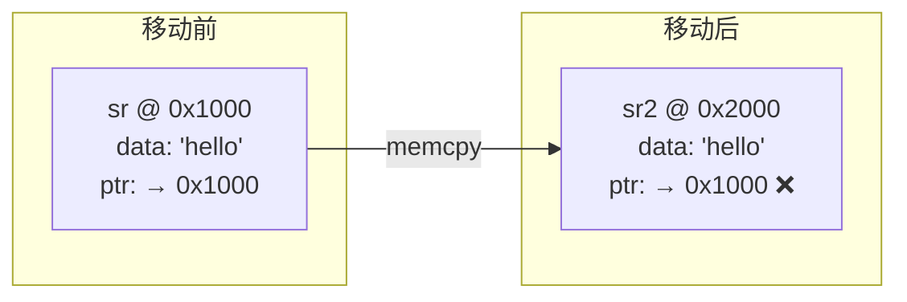
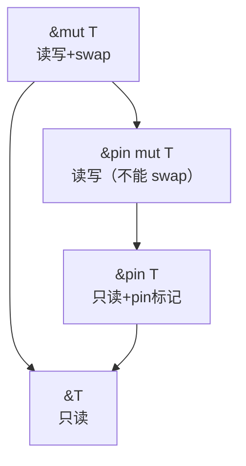

+++
title = "Explore Rust Pin：自引用、Future 与编译器的攻防"
description = "从自引用类型的悬空指针出发，逐层拆解 Pin 的设计意图：为什么 !Copy 还不够？Pin<&T> 是多余的么？pin! 宏的遮蔽在防什么？以及 &pin 的未来形态。"
date = 2026-07-24
draft = false
template = "blog/page.html"

[extra]
toc = true
+++

Rust 的 `Pin` 是一个让很多人望而生畏的概念。和其他语言特性不同，Pin 不是"学了就能用"——它解决的问题在日常代码中很少出现，
但又是 `async` 生态的基石。这篇文章试图从最根本的问题出发，把 Pin 的设计一层层拆开。

## 问题：自引用类型被移动后，指针悬空

假设你有这样一个结构体：

```rust
struct SelfRef {
    data: String,
    ptr: *const String,   // 指向 self.data 的裸指针
}

impl SelfRef {
    fn new(s: String) -> SelfRef {
        let mut sr = SelfRef { data: s, ptr: std::ptr::null() };
        sr.ptr = &sr.data as *const String;
        sr
    }
}
```

创建后直接使用——正常：

```rust
let sr = SelfRef::new("hello".to_string());
sr.print();  // ptr points to: hello  ✅
```

但移动之后：

```rust
let sr = SelfRef::new("hello".to_string());
let sr2 = sr;   // 移动！栈上字节被拷贝到 sr2，sr 失效
sr2.print();    // ptr 仍指向 sr 的旧地址 → 悬空！
```





**移动 = memcpy。** 对于普通类型（`i32`、`Vec`、`String`）这没问题——堆数据不跟着栈地址走。但自引用类型的指针指向的是**栈上地址**，memcpy 后地址全变了。

## 为什么借用检查器没拦住？

因为裸指针 `*const String` 绕过了借用检查器。安全 Rust 中你无法同时持有 `&self` 和 `&mut self.data`——借用检查器会报错。
但 `unsafe` 裸指针不受此限制。而现实中最大的自引用类型来源是**编译器生成的 `async` Future**：

```rust
async fn example() {
    let local = String::from("hello");
    do_something(&local).await;  // Future 内部持有对 local 的引用
}
```

编译器生成的匿名 Future 结构体包含了 `local` 和对 `local` 的引用——这就是自引用。这正是 **Future 通常 `!Unpin`** 的原因。

## Pin 的核心机制

Pin 的承诺很简单：**被 Pin 包裹的值，不会再被安全代码移动。**

```rust
use std::pin::Pin;

let value = SelfRef::new("hello".to_string());
let pinned = Pin::new(&mut value);  // 注意：这只能在 Unpin 类型上调用！
```

这里有三个概念要分清楚：

| 概念 | 含义 |
|---|---|
| `Pin<P>` | 一个"钉住"的包装，保证所指向的值不能移动 |
| `Unpin` | auto trait，标记此类型移动是安全的；Pin 对它透明 |
| `!Unpin` | 此类型移动不安全；Pin 真正的保护对象 |

`Unpin` 的命名很反直觉——它其实不是"解除 Pin"，而是"Pin-proof"（防钉的）。大多数类型（`i32`、`String`、`Vec<T>`）都是 `Unpin` 的，
因为移动它们不会产生悬空指针。Pin 包裹它们什么也不改变。只有自引用类型才 `!Unpin`。

Pin 的 API 设计是巧妙的不对称：

```rust
// 仅对 Unpin 类型可用 —— 安全
impl<P: Deref<Target: Unpin>> Pin<P> {
    pub fn new(pointer: P) -> Pin<P>;
    pub fn get_mut(self: Pin<&mut P>) -> &mut T;
}

// 所有类型都能用 —— 但不安全或只读
impl<P: Deref> Pin<P> {
    pub unsafe fn new_unchecked(pointer: P) -> Pin<P>;
    pub fn as_ref(&self) -> Pin<&P::Target>;
}
```

**`get_mut` 对 `!Unpin` 封死**——因为一旦拿到 `&mut T`，你就可以 `mem::swap` 把整块内存换走。

```rust
// 栈上 Pin
let v = pin!(MyFuture::new());     // 1.68+ 稳定

// 堆上 Pin（最常用）
let v = Box::pin(MyFuture::new()); // Box 保证堆地址不变
```

## 追问一：为什么 `!Copy` 还不够？

这里有一个容易被忽略的点。`!Unpin` 的类型必然是 `!Copy` 的，而 `!Copy` 已经阻止了通过 `&T` 的移动。那为什么还需要 Pin？

**因为 `&mut` 比 `&T` 危险得多：**

```rust
let mut a = SelfRef::new("hello".to_string());
let mut b = SelfRef::new("world".to_string());

// 安全 Rust！编译器完全允许！
std::mem::swap(&mut a, &mut b);
// a 和 b 的字节完全交换
// a.ptr 仍指向 b 原来的栈地址 → 悬空
```

```
                  &T              &mut
!Copy 是否阻止？  ✅ 阻止           ❌ 不阻止（swap 不需要 Copy）
Pin 是否阻止？    N/A 不需要        ✅ 封死 get_mut
```

**Pin 的本质不是阻止普通移动，而是剥夺 `&mut` 造成的"原地交换/替换"能力。**
整个 Pin 体系的运行时价值浓缩于一处：对 `!Unpin` 类型的 `Pin<&mut T>`，不给 `get_mut`。

## 追问二：`Pin<&T>` 是多余的吗？

如果你看到 `&T`，它已经阻止了 swap/replace——不需要 Pin。那 `Pin<&T>` 还有什么价值？

**答案：类型系统的 plumbing，没有额外的运行时安全保障。**

```rust
// as_ref 保持 Pin 链不断
let p_mut: Pin<&mut MyFuture> = ...;
let p_ref: Pin<&MyFuture> = p_mut.as_ref();  // Pin → Pin
let raw:   &MyFuture      = p_ref.get_ref(); // Pin → &T，降级
```

`Pin<&T>` 的存在是为了：
1. **API 一致性**——`as_ref()` 保持 Pin 包装，让下游泛型代码统一处理 `Pin<impl Deref>`
2. **契约标记**——签名中写出 `Pin<&dyn Future>`，类型层面告知"这个值是被钉住的"
3. **防止降级后回不去**——如果 `as_ref` 直接返回 `&T`，再想回到 `Pin` 就得 unsafe

但在运行时，`Pin<&T>` 和 `&T` 的行为完全一样。`Pin::get_ref()` 就是设计师给你开的"降级"后门。

## 追问三：`pin!` 宏的遮蔽在防什么？

`pin!` 的实现技巧是**变量遮蔽**：

```rust
macro_rules! pin {
    ($x:expr) => {{
        let mut __value = $x;                                // (1)
        let __value = unsafe { Pin::new_unchecked(&mut __value) }; // (2) 遮蔽！
        __value
    }};
}
```

不禁要问：既然 `Pin<&mut T>` 持有了 `&mut`，借用检查器已经阻止了通过原始变量移动，遮蔽还有什么用？

**遮蔽封死的是 Pin 生命周期之外的路径：**

```rust
// 路径一：Pin drop 后，原始变量复活
let mut v = MyFuture::new();
{
    let p = unsafe { Pin::new_unchecked(&mut v) };
} // p drop，&mut 归还 → v 又可以访问了！如果传给了需要 Pin 的上下文 → UB

// 路径二：unsafe 中取裸指针绕开
let ptr = &raw const v;
unsafe { ptr.read(); }  // 编译器不管
```

**遮蔽将原始绑定从命名空间中消除。** 这是一种纵深防御：不是靠生命周期分析来保证安全，而是靠类型系统级别的不可达来消除旁路。

## 追问四：Pin + Future = async 的安全基石

看 `Future::poll` 的真实签名：

```rust
pub trait Future {
    type Output;
    fn poll(self: Pin<&mut Self>, cx: &mut Context<'_>) -> Poll<Self::Output>;
    //         ^^^^^^^^^^^^^^^^ 不是 &mut self
}
```

如果 poll 接受普通的 `&mut self`，调用方可以：

```rust
mem::swap(&mut future_a, &mut future_b);  // 两个 Future 的状态全部错乱
```

`Pin<&mut Self>` 封死这条路——这是 async 生态不自毁的前提。

## 追问五：既然 `&mut` 被封死了，怎么修改字段？

这是 Pin 最实用的拷问。`Pin<&mut Self>` 不给 `get_mut`，但 `Future::poll` 中你必然需要更新内部状态。矛盾怎么解？

答案是**结构投影（Struct Projection）**——字段本身不参与自引用的部分，可以安全拿到 `&mut`。
只需要向编译器证明"这个字段的 `&mut` 不会导致整体被移动"。

### `pin_project` 做了什么

```rust
use pin_project::pin_project;

#[pin_project]
struct MyFuture<F: Future> {
    counter: usize,           // 普通字段，可以 &mut
    #[pin]
    inner: F,                 // !Unpin 字段，需要 Pin 投影
}

impl<F: Future> Future for MyFuture<F> {
    type Output = ();
    fn poll(self: Pin<&mut Self>, cx: &mut Context<'_>) -> Poll<()> {
        let this = self.project();

        *this.counter += 1;          // ✅ &mut usize，随意修改
        this.inner.poll(cx)          // ✅ Pin<&mut F>，递归钉住
    }
}
```

`#[pin_project]` 宏展开后生成的核心签名：

```rust
impl<F: Future> MyFuture<F> {
    fn project<'a>(self: Pin<&'a mut Self>) -> Projection<'a, F>;
    fn project_ref<'a>(self: Pin<&'a Self>) -> ProjectionRef<'a, F>;
}

struct Projection<'a, F: Future> {
    pub counter: &'a mut usize,        // 普通字段 → &mut
    pub inner: Pin<&'a mut F>,         // #[pin] 字段 → 保持 Pin
}
```

| 原始字段 | `project()` 得到 | 能否修改 |
|---|---|---|
| `counter: usize` | `&'a mut usize` | ✅ 随意改 |
| `#[pin] inner: F` | `Pin<&'a mut F>` | ✅ 调用 `poll` 等 Pin 方法 |

### 安全原理

`project()` 同时借用了结构体的所有字段，但返回的是**结构化借用**——Rust 允许对不同字段同时持有 `&mut`。
`pin_project` 额外保证了拿普通字段的 `&mut` 不会意外调用 `mem::swap` 等方法把整个结构体换走
（确保你在字段访问的上下文中不会对 `Self` 做整体操作）。

本质上`pin_project` 把两件事自动化了：

1. **普通字段**：unsafe `get_unchecked_mut` → 安全 `&mut`
2. **`#[pin]` 字段**：unsafe 重建 `Pin<&mut Field>` → 安全 Pin 投影

开发者面对的是安全接口，unsafe 被限制在宏生成的代码内——审查负担从"整个 poll 方法"缩小到"宏本身的一次性信任"。
 
## 展望：`&pin`——Pin 从库到语言的升级

目前 Pin 是**库层面**的设计：`Pin<P>` 是一个包装类型，依赖 trait 门禁和 unsafe 契约。
Rust 团队正在探索把 Pin 提升为**语言层面的原生引用类型**：

```
现状（库）：                        愿景（语言）：
Pin<&mut T>                        &pin mut T
Pin<&T>                            &pin T
```





在 `&pin` 世界里，不需要 `#[pin]` 标注，不需要 `pin_project` 宏——编译器看类型就知道哪些字段需要 Pin 投影。
`&mut → &pin mut` 是安全的、自动的降级（放弃 swap 能力即可）。Unpin 类型下，四者完全等价。

### 用 `&pin` 的类型格重新理解 Pin

回头看 Pin 的 API 设计——为什么 `Pin::new` 只对 `Unpin` 类型可用？为什么 `get_mut` 对 `!Unpin` 封死？
在 `&pin` 的类型偏序格下，这些设计变得一目了然：

- **`Pin::new`** 本质是从 `&mut T` 构造 `&pin mut T`——对于 `Unpin` 类型两者等价，所以安全；对于 `!Unpin` 类型需要放弃 swap 能力，必须 unsafe 确认。
- **`Pin::get_mut`** 本质是从 `&pin mut T` 取回 `&mut T`——Unpin 下两者等价故安全；`!Unpin` 下不可逆（恢复 swap 能力意味着破坏钉住承诺），所以 unsafe。
- **`Pin<&T>`** 本质是 `&pin T`——对于只读引用，钉不钉完全没区别，这就是为什么 `Pin::get_ref()` 直接返回 `&T`。

整个 `Pin<P>` 的 API 体系，就是一张能力格用 trait 门禁和 unsafe 契约**模拟**出来的。而 `&pin` 将这张格直接编码进了类型系统。

不过 `&pin` 仍在 Nightly 实验阶段（`#![feature(pin_ergonomics)]`）。核心阻塞点是 borrowck 语义：
`&pin mut` 的效果在引用归还后仍然延续——打过 `&pin mut` 的栈位置，之后也永久不能移动。这和传统 borrow 的直觉有冲突。
最早 2027 年才有可能稳定。

## 总结

1. **Pin 解决的是自引用类型的移动安全问题**——移动 = memcpy，自引用指针悬空。
2. **Pin 真正要堵的漏洞是 `&mut` 的 swap**——`!Copy` 只能防 `&T`，防不了 `mem::swap(&mut a, &mut b)`。
3. **整个 Pin 的运行时价值浓缩于一处**：`!Unpin` + `Pin<&mut T>` → 不给 `get_mut`。其余都是类型 plumbing。
4. **`pin!` 的遮蔽是纵深防御**——消除 Pin 生命周期之外的旁路攻击面。
5. **Pin 是"防君子不防小人"**——`unsafe get_unchecked_mut` 可以绕开，但规范了审查边界：你只需要审查那几个 unsafe 调用点。
6. **`&pin` 代表未来方向**——把 Pin 从库契约升级为编译器类型规则。

Rust 的 Pin 学习曲线高，核心原因是它同时涉及自引用、移动语义、unsafe 契约三个概念。但一旦理解它只做一件事——**用类型系统剥夺 `&mut` 的 swap 能力**——整个设计就清晰了。
